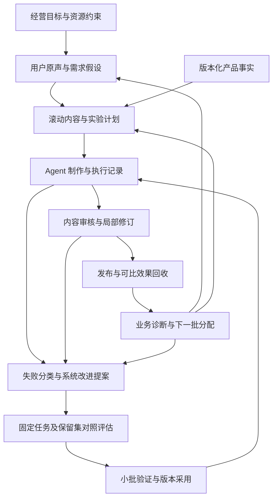

# 从内容生产到持续学习：交互模式、业务与 Agent 双闭环及 RSI 演进方案

版本：v1.0
日期：2026 年 10 月 10 日
适用对象：业务负责人、内容负责人、投放/运营负责人、视频生成 Agent 与研发团队
文档性质：基于近期实践的复盘与实施建议。本文的新增数据结构、自动化、流程调整和 RSI 能力均为建议，不代表已经实现或验证；文档编写不触发视频生成、投放或系统发布。

---

## 阅读摘要

当前流程已经具备内容经营系统的主要组成部分：业务目标、用户原声、需求洞察、钩子、内容结构、产品事实、视频生成、飞书审核以及迭代。近期最有价值的变化，是从“对整条成片进行笼统修改”，转向“冻结已接受的主体，对开头等局部因素开展版本化实验”。

但这些组成部分连接起来，不等于学习闭环已经完成。当前可确认的是：人工反馈能够推动局部生产改进；尚不能据所检查的记录确认，真实经营结果已经持续反哺下一轮内容分配，或 Agent 的改进已经在独立任务上稳定成立。

需要建立两条相互连接、分别评估的闭环：

1. **业务闭环：**识别什么需求、内容和商品组合在什么人群与分发条件下有效，并据此调整下一批计划。
2. **Agent 闭环：**识别哪些生成策略、工具、提示词与工作流程能够更稳定、更低成本地完成任务，并用独立评估决定是否采用。

两条闭环共享可追溯数据，但不能混用成功标准。内容负责人喜欢，不等于消费者愿意购买；一次出片漂亮，不等于 Agent 的平均能力提高；播放量提高，也不必然带来更好的经营结果。

下一阶段建议先跑通一个小而完整的闭环：从一条可追溯需求出发，形成可比内容实验，回收审核与线上效果，明确改变下一批内容计划和一个 Agent 策略，再分别验证两种改变。100 条计划作为滚动生产额度，由每批证据决定后续分配。

RSI 在本文中指 Recursive Self-Improvement，即递归自我改进。可以向这一方向演化，但近期更现实的目标是“可评估、可回退的 Agent 自我改进”。只有当系统对自身的改进，也提高了下一轮发现和验证改进的能力，才开始具备递归性质。

## 目录

1. 分析范围与证据边界
2. 最近一段时间的交互模式
3. 当前模式的优势、劣势与瓶颈
4. 从数量目标到经营目标
5. 内容洞察：从用户原声到可测试需求
6. 内容计划：从排产表到实验组合
7. 产品事实与两类视频生产路径
8. 业务闭环与 Agent 闭环的连接方式
9. 飞书多维表格的数据与协作设计
10. 用户反馈、受众反馈与业务数据反馈
11. Agent 改进的评估、固化与发布
12. 从持续优化到 RSI
13. 下一轮 100 条的滚动执行方案
14. 分阶段落地、职责与验收
15. 可直接使用的工作模板
16. 证据索引与参考资料

---

## 1. 分析范围与证据边界

### 1.1 本文依据

本次重点检查了“毛巾批量视频生成”的近期可读取记录、9 月 29 日原声核验文档、10 月 8 日生产复盘与迭代规范、10 月 10 日审核及开头实验产物，并参考了项目既有质量与业务反馈设计。

本文没有对全部历史会话、飞书实时数据和线上投放账户进行全面审计。因此，下文的“尚未证明”表示所检查材料不足以支持结论，不等同于断言相关能力或数据在其他地方不存在。

### 1.2 四种证据状态

| 状态 | 本文中的含义 | 使用限制 |
|---|---|---|
| 已发生 | 有对应日期、文件或执行记录 | 只说明该次发生，不自动推广到全部生产 |
| 已形成规范 | 文档中已定义规则、指标或机制 | 文档存在不代表运行时已执行 |
| 已验证 | 有明确比较条件、评价与足够证据支持限定结论 | 需要写明适用范围、样本与限制 |
| 本文建议 | 根据现状提出的实施方案 | 需要后续实现与验收 |

### 1.3 当前可以确认的关键事实

| 时间 | 证据 | 可以支持的结论 | 不能据此推出 |
|---|---|---|---|
| 9 月 29 日 | 两个母片的 24 条纸面开场候选；三条原声文档来源登记；31 个原钩子的分类处置 | 已开始将来源、购买问题、承诺和后文承接结合筛选 | 候选具有已验证的爆款概率；原声均完成平台核验 |
| 10 月 8 日 | 卖点 A/B 样片生产复盘 | 动态素材、共用正文、配音与合成路线可执行；存在真实质量问题与记录缺口 | 两条片已获得完整生产认证；A/B 已形成经营赢家 |
| 10 月 8 日 | 生产复盘与制作评估规范 | 已提出四张成绩单、版本比较、保留集、失败入账等规则 | 自动评估与策略晋升已全面实现 |
| 10 月 10 日 | 18 条成片的反馈与返工计划 | 用户明确要求增强防臭场景表达和前三秒冲击力，并限定已接受范围 | 其他自动检查失败可以被人工意见覆盖；未来版本自动通过 |
| 10 月 10 日 | 六条动态开头预览验收记录 | 六条三秒预览技术检查通过，绑定两个主体，等待人工反馈 | 已形成六条完整新片；已计入 300 条；已带来线上效果提升 |

原声核验文档明确区分“问题改写”和“创意假设”。原 300 条方案也将部分用户表达明确标为创意假设。后续数据建模必须继续保留这种区分。[E1][E2][E3][E4][E5]

## 2. 最近一段时间的交互模式

### 2.1 主导模式：人提出方向，Agent 产出对象，人通过对象校准标准

实际交互通常不是一次给完全部要求，而是以下循环：

> 经营意图 → Agent 提出方案 → 小批样片 → 人看到具体问题 → Agent 将意见转为制作规则 → 局部返工 → 新版本审核。

这种模式适合尚在形成表达标准的业务。诸如“有冲击力”“有质感”“能体现卖点”等要求，只有结合具体画面、声音和节奏，才容易转成双方理解一致的标准。

其中，人提供目标、取舍和最终判断；Agent 负责扩展候选、组织制作、执行工具和保存过程证据。交互质量取决于每次反馈能否减少下一轮的不确定性。

### 2.2 六种值得保留的模式

| 模式 | 输入与行为 | 价值 | 下一步可固化的形式 |
|---|---|---|---|
| 业务目标拆解 | 从数量、产品和内容方向拆成批次及单条任务 | 将泛化需求转成可执行对象 | 业务目标卡、批次任务卡 |
| 来源约束创意 | 将原声、产品事实与钩子承诺对应 | 降低脱离需求或无法兑现的表达 | 需求卡、事实卡、承诺检查 |
| 代表样片校准 | 先制作少量代表作，再决定扩量 | 用较低成本暴露路线与质量问题 | 首件审核、批次放行规则 |
| 冻结主体做变体 | 保持正文，替换开头或其他约定因素 | 降低返工量，提高可比性 | 母片版本、模块接口、差异记录 |
| 反馈约束返工范围 | 明确哪些通过、哪些需要修改 | 防止修一个问题时破坏已接受部分 | 带时间点的反馈卡与变更范围 |
| 经验转为可检验规范 | 记录事实边界、质量问题、计数和评价规则 | 让经验有机会跨任务复用 | 检查器、skill、评估样本 |

这些模式成熟程度不同。局部开头实验已有本轮实例；业务数据自动回流、跨任务策略晋升仍需要进一步核验与建设。

### 2.3 当前用户承担的隐藏工作

用户同时承担了经营负责人、创意总监、内容审核员、项目协调者，以及 Agent 行为纠偏者的角色。许多必要判断仍通过聊天完成：

- 解释业务目标为什么重要。
- 判断钩子是否有购买相关性。
- 指出画面是否真实体现了所说内容。
- 区分本条片的问题和系统性问题。
- 确认已批准范围及下一步是否可以扩量。
- 提醒哪些成果应沉淀为规范，而不是留在会话中。

这些判断有较高价值，但不应全部随着产量线性增加。后续应保留人的目标设定与关键取舍，把状态搬运、版本匹配、重复检查和问题汇总交给系统。

### 2.4 建议演化后的日常交互

每批开始时，人只需确认经营目标、优先假设、预算和允许自动推进范围。制作期间，Agent 报告异常与影响，不逐条要求重复判断已经约定的事项。每批结束时，系统提交三类结论：

1. **这批学到了什么：**哪些假设获得支持、被削弱或证据不足。
2. **下一批具体变什么：**需求、结构、数量、生产路径和预算如何调整。
3. **系统准备改什么：**候选改进、适用范围、验证方式与回退版本。

该交互方式属于建议；正式落地时应将批次授权与现有阶段门对齐，避免把“方向认可”误读为所有后续动作已授权。

## 3. 当前模式的优势、劣势与瓶颈

### 3.1 优势

**从真实需求出发。** 用户原声提供场景、顾虑和表达方式，使内容更接近消费者决策，而非单纯罗列产品功能。

**把创意与产品事实连接。** 事实卡约束钩子和主体承诺，减少“开头吸引人但产品接不住”的情况。

**兼容复用与探索。** 参考片改编降低结构探索成本；纯 AI 路径扩展动作、场景和表达空间。两者可以作为不同实验路径。

**小批审核减少错误扩散。** 当同类问题可能影响几十条内容时，先校准代表样片有较高收益。

**业务团队能够参与。** 飞书提供熟悉的协作入口，内容负责人不必理解底层生成参数，也能完成审核和管理。

**已经开始保留比较条件。** 冻结主体、保留基准、绑定版本，为后续实验归因提供了基础。

### 3.2 劣势

| 问题 | 为什么发生 | 对业务与系统的影响 |
|---|---|---|
| 数量目标压过学习目标 | “完成 100 条”容易计数，“验证需求”需要额外定义 | 大量产出可能重复同一错误假设 |
| 原声热度被当作需求价值 | 频次、点赞、购买动机缺少分层 | 内容可能吸引讨论，却不能促进目标行为 |
| 审核标准依赖个人经验 | 自然语言意见没有时间点、原因和锚点 | 同类问题反复解释，审核难以委托 |
| 多因素同时变化 | 开头、配音、音乐、动作一起修改 | 能比较整套方案，但不能定位哪个因素起作用 |
| 局部美化替代经营诊断 | 最容易修改的是视频 | 商品、价格、受众或承接页面问题被错误转给 Agent |
| 历史信息分散 | 聊天、文件、工作台、飞书各存一部分 | 重复读取、审批错配、旧版本覆盖与恢复困难 |
| 只记录成功结果 | 淘汰、重试、等待和人工介入未充分计入 | 高估系统效率，低估每条合格内容成本 |
| 规则持续增加 | 每次失败都可能新增要求 | 规则互相冲突、关键路径变长、创作空间缩小 |

### 3.3 最可能限制下一阶段规模的三个瓶颈

1. **审核带宽。** 出片更快但反馈积压，会使系统继续生产尚未校准的内容。
2. **实验可解释性。** 有数据但比较条件不同，仍无法可靠指导下一批。
3. **反馈转为默认行为的能力。** 同一问题本轮修好，下轮仍发生，说明经验没有进入适当的规则、工具或素材层。

因此，近期优化重点应同时包含“减少每条的人工判断次数”和“提高每次判断的复用价值”。

## 4. 从数量目标到经营目标

### 4.1 100 条是交付约束，需要经营目标配套

一个完整目标至少包含五部分：

| 部分 | 应回答的问题 |
|---|---|
| 经营目标 | 提升什么：有效点击、购买、线索、品牌认知，还是验证需求？ |
| 范围 | 针对哪个 SKU、受众、账号、平台和使用场景？ |
| 资源 | 生产、审核、分发预算和时间分别是多少？ |
| 成功标准 | 对什么基线、在什么窗口和有效样本条件下作判断？ |
| 学习目标 | 本轮最需要减少哪几个不确定性？ |

目标示例：在约定周期与预算内，为某一 SKU 生产最多 100 条正式内容，验证三类购买顾虑与两类内容结构，寻找能够在可比分发条件下改善商品点击且不损害后续转化的方向。具体阈值在建立基线后事前登记。

这里的“最多”用于保留滚动调整空间。合同明确要求交付 100 条时，应将交付义务与实验配额分开管理，不能因学习需要擅自取消交付。

### 4.2 三张并列看板

| 看板 | 主要内容 | 避免的误判 |
|---|---|---|
| 交付看板 | 计划、制作、验收、发布、观察、已结算数量 | 把三秒节选、重复导出当新作品 |
| 经营看板 | 按目标分组的效果、样本、窗口与分发条件 | 把播放量或某个高分当经营成功 |
| 学习看板 | 已登记假设、已完成实验、被采用策略、未解决问题 | 只看产量，不看是否产生可复用结论 |

有效内容比例必须同时显示观察覆盖率。还未发布、样本不足或仍在观察的内容应单列，不能悄悄计为失败，也不能从全流程报告中消失。

## 5. 内容洞察：从用户原声到可测试需求

### 5.1 原声的三种用途

1. **发现需求：**用户在什么场景下遇到什么问题。
2. **学习语言：**用户怎样描述问题、取舍与担忧。
3. **发现供给缺口：**颜色、规格、包装、组合或服务是否需要变化。

第三类反馈往往应进入商品或服务决策。不能因为当前生产工具是视频，就把所有需求强行转成内容问题。

### 5.2 最小处理流程

> 采集 → 保存原文和来源 → 去重与渠道标记 → 聚类为需求 → 区分原话/解释/创意改写 → 关联商品事实 → 形成实验假设。

最小原声记录应包括：来源链接或 ID、采集时间、原始文本、渠道、关联商品或未知状态、使用场景、购买意向线索、售前/售后属性、去重组和核验状态。

同一内容在多个平台被搬运、同一用户重复表达、热门帖子下的相似评论，都可能夸大频次。缺少代表性采样时，频次只能描述已采样语料，不能声称代表全部目标消费者。

### 5.3 分开管理需求价值、证据强度与测试价值

不建议把所有信息压成一个未经校准的“爆款分”。至少保留三个判断：

| 判断 | 主要依据 | 对计划的作用 |
|---|---|---|
| 需求价值 | 问题严重性、购买关联、商品匹配、经营价值 | 决定值得服务哪些需求 |
| 证据强度 | 来源可靠性、去重后覆盖、渠道一致性、时间新鲜度 | 决定判断有多确定 |
| 测试价值 | 当前不确定性、潜在收益、可视化可行性、测试成本 | 决定先测哪些假设 |

原 300 条方案已有需求具体性、商品匹配、可视化证据、品牌适配与低成本测试的内部排序权重。这可以保留为当前工作流基线，但应标明它是人工设定的优先级规则，并用后续结果检验，而不是平台规律。[E1]

### 5.4 从需求到钩子的中间对象：需求假设卡

例如：

- 原声线索：用户表示买前难判断毛巾的细节与质感。
- 解释：可能存在“商品信息不够直观”的购买障碍。
- 产品可支持事实：当前可展示毛圈、包边和外观。
- 钩子假设：用明确的观察问题，引导用户继续看细节。
- 主体承接：正文确实给出相应部位的清楚画面。
- 待验证结果：是否改善有效观看与商品点击。

这条链中，每一步都应区分证据与解释。原声没有说过的句子不能以真实买家引语呈现；AI 生成的抚摸画面不能证明真实触感。

### 5.5 下一轮如何更新洞察

更新不仅来自内容播放，也来自点击后的问题、客服咨询、购买评价和退款原因。如果评论关注“有没有礼盒”，应检查商品供给；如果反复问片中已解释的规格，应检查表达是否清楚；如果停留高但点击低，应重新检验内容与购买意图的连接。

保留探索配额，防止系统只追随已知高频主题。比例根据预算与目标确定，不把固定的探索比例当成普适最优值。

## 6. 内容计划：从排产表到实验组合

### 6.1 内容计划需要同时描述交付与学习

每个计划单元至少写清：需求、目标人群、SKU、内容结构、钩子假设、主体证据、行动引导、生产路径、对照关系、预计成本和审核负责人。

可以用以下维度组织候选，但不应直接生成全组合：

> 需求 × 内容结构 × 钩子表达 × 商品 × 场景 × 生产路径。

组合数容易爆炸。首先根据事实可兑现性、素材条件和业务优先级缩小范围，再设计少量能够回答问题的实验。

### 6.2 区分探索与优化

| 类型 | 允许改变什么 | 合理结论 |
|---|---|---|
| 探索实验 | 可以比较不同需求、结构或完整表达方案 | 哪一整套方案更值得继续 |
| 优化实验 | 锁定主体及其他约定因素，只改变主要测试因素 | 在限定条件下，该因素变化的效果 |
| 生产路线实验 | 尽量固定目标、脚本和质量要求，比较参考改编与 AI 等路线 | 哪条路线更适合某类任务，成本与稳定性如何 |
| 系统版本实验 | 固定任务集与评估规则，比较 Agent 策略版本 | 新版本是否提高任务完成能力 |

如果同时换口播、动作与构图，可以称“开头方案比较”，不宜称“某个单词的效果测试”。即使只替换前三秒，不同开头与正文的匹配程度也可能不同，仍需完整片验证。

### 6.3 每个实验在执行前锁定的内容

- 假设、比较类型、主指标和重要护栏。
- 基准版本、候选版本、固定项与变化项。
- 分发方式、观察窗口、样本要求与停止规则。
- 预算、审核方式、版本与原始数据保存方式。
- 允许得出的结论，以及本次不能回答的问题。

不依据看到的结果临时换主指标或阈值。频繁看数、多个候选中挑最好的一条，会增加偶然赢家风险；探索结果应另做确认，而不是直接成为通用规则。

## 7. 产品事实与两类视频生产路径

### 7.1 产品事实贯穿流程

事实应在写钩子前进入任务，而不是最后给成片补免责声明。一个事实条目应包含 SKU、声明、来源类别、证据引用、有效期或更新时间、允许措辞、视觉表达边界和版本。

来源类别至少区分：商品资料、商家宣称、可观察外观、独立检测、实际使用记录。不同类别支持不同强度的表达，不能通过生成画面提升证据等级。

例如，“防臭”可以在已允许措辞内作为商家主张使用，但“AI 画面中气味消失”不能成为性能证明。近期审核的合理修改方向，是让“担心使用后有味”的场景更可感，同时保留商品事实边界。[E2][E3]

### 7.2 参考片改编与纯 AI 生成

| 维度 | 基于参考片改编 | 纯 AI 生成 |
|---|---|---|
| 主要价值 | 复用叙事、节奏或已接受的主体 | 探索新场景、动作、构图与表达 |
| 核心输入 | 参考用途、可用素材范围、结构分析、产品事实 | 脚本、分镜、商品参考图、动作与一致性要求 |
| 常见失败 | 钩子与正文不匹配；品牌或商品迁移不成立；接缝不自然 | 商品漂移、手部异常、动作未执行、画面无法兑现文案 |
| 优化单位 | 开头、节奏段、文案、配音或局部镜头 | 镜头策略、参考输入、生成参数与素材选择 |
| 评价重点 | 整体连贯性与本品适配 | 事实、商品、动作与声音的一致性 |

参考片在其他条件下的成功，只构成待检验线索。两条路径应按任务类型分别统计成本和合格率，避免把简单改编任务与高难生成任务直接混算。

### 7.3 模块化要有语义接口

把视频拆成开头、正文、证明段和结尾，有助于局部返工。但模块接口需要描述：开头承诺、正文第一句、首个回答出现位置、画面连续性、音频接缝和总时长约束。

只有时长接口、没有语义接口，容易出现“前三秒提出防臭问题，正文只展示包边”的错配。技术拼接通过后，还必须完整观看和试听。

### 7.4 最小返工策略

先定位问题属于需求、承诺、脚本、素材、配音、字幕还是合成，再选择最小可修复单元。对于换款、主体未完成动作等问题，重排字幕通常无法修复；对于字幕布局或尾音截断，也不应直接重生成全部视频。

已接受部分应绑定具体版本保留。局部修改导致声音、总时长或接缝变化时，重跑受影响检查，不能沿用不再适用的旧结论。

## 8. 业务闭环与 Agent 闭环的连接方式

### 8.1 目标架构



这是目标连接方式，不表示各箭头已经自动化。

### 8.2 三种学习应分别落地

| 学习对象 | 典型输入 | 应改变的对象 |
|---|---|---|
| 消费者与商品理解 | 原声、咨询、购买、退款、分人群表现 | 需求库、商品问题清单、目标人群 |
| 内容策略 | 钩子/结构实验、观看与点击行为 | 内容配额、表达选择、主体承接 |
| 生产能力 | 质量缺陷、重试、成本、等待、审核意见 | 提示词、skill、工具、流程和素材库 |

业务数据可以提出 Agent 改进假设，但不能跳过定位。例如留存低可能是选题不匹配、投放人群偏差或开头执行失败，应先检查证据再决定修改层。

### 8.3 两条闭环的时间尺度

生产问题通常可以在本批内定位并修复；经营效果需要等待分发与观察；系统升级还需要覆盖多个任务。建议使用三个节奏：

- **单条/当日：**拦截质量问题，进行局部修复。
- **批次/周度：**结合已成熟数据更新内容计划；未成熟数据保留观察状态。
- **系统升级周期：**选择具有复用价值的问题，完成固定任务评估、小批验证和版本发布。

不要让线上数据等待阻塞所有制作，也不要用快速的人工评分替代尚未成熟的经营结果。

## 9. 飞书多维表格的数据与协作设计

### 9.1 定位：业务协作与证据索引

飞书适合作为计划、审核、状态和实验结论的协作入口。视频文件、原始 API 回执、完整执行日志和大量版本文件可保存在现有资产系统或项目目录，由飞书关联。

每个字段应指定唯一权威来源：谁产生、谁可修改、同步方向是什么。避免工作台显示已通过、飞书显示待修改，而系统不知道采用哪一个状态。

### 9.2 建议的数据对象

下表是逻辑对象，不要求第一天就拆成八张独立表。

| 对象 | 核心字段 | 关联 |
|---|---|---|
| 需求与原声 | source_id、原文、渠道、时间、核验状态、去重组、insight_id、假设 | 内容任务、后续新反馈 |
| 产品事实 | fact_id、SKU、声明、来源、证据、允许表达、版本 | 需求假设、脚本、成片 |
| 业务计划 | campaign_id、目标、预算、期限、负责人、交付口径 | 批次、实验、任务 |
| 实验 | experiment_id、假设、对照、变量、指标、样本规则、窗口、结论 | 各候选成片、线上观测 |
| 内容与版本 | work_id、version_id、母片、结构、钩子、Agent 策略版本、资产链接、状态 | 需求、事实、实验、审核 |
| 审核反馈 | review_id、成片版本、审核人、时间点、问题标签、决策、理由 | 返工任务、新版本 |
| 发布与观测 | publication_id、平台内容 ID、账号、分发条件、时间、窗口、分子分母、原始导出 | 成片版本、实验 |
| 改进与评估 | improvement_id、问题证据、变更对象、新旧版本、评估集、结果、采用/回退 | 原始失败、相关实验、策略版本 |

### 9.3 MVP 可以先做四组表

1. **内容任务与版本表：**存交付与制作状态，并关联现有产品事实。
2. **实验与需求表：**先将需求摘要、来源引用和实验计划放在一起，保留独立 ID。
3. **审核事件表：**每次审核新增记录，关联具体版本。
4. **发布与效果表：**每次发布或观测窗口一条记录，关联具体版本。

当复用频率和记录量增加，再拆独立需求表、事实表和系统改进表。不要为了完整模型而延迟第一轮有效实验。

### 9.4 三种身份不能混淆

- **work_id：**独立内容任务。用于交付计数。
- **version_id：**某次具体成片。用于审核、质量、返工与效果归因。
- **publication_id：**某平台、账号和时间的一次发布或分发实例。用于业务观测。

同一作品的多个修改版本不自动增加交付数；同一版本多次发布，也不能当作多个独立创意。素材级或母片级相关性应保留在分析中。

### 9.5 状态与同步规则

建议把状态拆开，而不是只放一个“已完成”：

| 状态域 | 示例状态 |
|---|---|
| 制作 | 待排产、制作中、待修复、制作完成 |
| 技术与事实检查 | 未运行、通过、失败、不适用、错误 |
| 人工审核 | 待审核、条件接受、需修改、最终接受、淘汰 |
| 发布 | 未安排、待发布、已发布、已撤下 |
| 经营观察 | 待回收、观察中、样本不足、已结算 |
| 实验结论 | 改善、退化、有取舍、持平、证据不足 |

技术实现建议：使用稳定 ID 幂等同步；人工意见保留原文；更新记录带时间和来源；冲突显式显示；新版本新增记录，不覆盖历史媒体与审核；同步失败进入重试队列，不据此重复生成付费资产。

### 9.6 角色视图

- 业务负责人看预算、交付漏斗、已验证方向和下一批分配。
- 内容负责人看待审视频、时间点批注、基准对比和修改范围。
- 运营负责人看发布安排、平台 ID、效果缺失和观察到期。
- Agent 看可执行任务、版本约束、事实引用、失败原因和 next_action。
- 系统维护者看重复故障、评估证据和候选策略版本。

## 10. 用户反馈、受众反馈与业务数据反馈

### 10.1 三类反馈分开保存

| 来源 | 主要回答的问题 | 局限 |
|---|---|---|
| 业务/内容负责人 | 是否符合 brief、品牌、事实和创作要求 | 单人判断可能包含个人偏好 |
| 目标受众 | 看懂什么、在意什么、还有什么顾虑 | 评论者不一定代表全部观看或购买人群 |
| 业务数据 | 在具体分发条件下发生了什么行为 | 受流量、人群、价格、页面和时间等因素影响 |

制作 Agent 自评和机器 Judge 也要明确标注身份，不能被展示为独立人工意见。

### 10.2 让审核可执行

有效反馈最好包含：具体版本、时间区间、观察到的问题、期望变化、必须保留的部分和决定。

例如：“0–3 秒画面只有慢速抚摸，看不出‘选购三看’的观察重点。请增加全貌到细节的明确变化；正文、配音主体和结尾保留。”这比“更有冲击力”更容易定位、执行和复验。

建议问题标签包含：需求不匹配、承诺无法兑现、钩子不清、主体信息不足、节奏、商品一致性、动作缺失、配音、字幕、品牌、接缝、工具失败、状态/版本错误。严重程度与问题标签分开，避免把所有反馈都当硬性缺陷。

### 10.3 一次反馈的三个去向

1. 本条修改：生成最小返工任务。
2. 同批检查：查找是否有相同条件下的同类问题。
3. 系统学习候选：记录失败模式，判断是否需要规则、skill、工具或素材更新。

第三步不等于自动固化。孤立偏好、特殊 brief 的要求和偶发模型失误，不应直接成为全局规则。

### 10.4 指标口径

| 指标 | 推荐定义或记录要求 |
|---|---|
| 首次合格率 | 第一次完整制作尝试即满足适用验收条件的任务数 ÷ 已完成判定任务数；待审单列 |
| 每条合格成本 | 本批相关生产、失败、淘汰、返工及约定分摊成本 ÷ 最终验收独立作品数；分母为零时未定义 |
| 人工介入时间 | 人工主动处理分钟数；等待审核时间另列 |
| 实验周期 | 假设锁定至可作结论的墙钟时间；拆分生产、审核与观察等待 |
| 三秒留存、点击率、转化率 | 记录平台定义、分子分母、窗口及事件口径，不能跨定义直接比较 |
| 有效内容比例 | 满足预先定义业务条件的已结算内容数 ÷ 相应已结算合格口径内容数，同时展示结算覆盖率 |
| 学习产出 | 完成证据审查且实际影响下一批决策的结论数；结合质量审查，不以数量单独考核 |

现金费用和完整成本分开；估算和实付分开；未知不填零。独立作品、候选、素材和 API 调用分别计数。

### 10.5 业务诊断的方向

| 观察现象 | 优先检查方向 | 结论限制 |
|---|---|---|
| 曝光不足 | 发布、分发、人群、选题覆盖、样本窗口 | 不足以认定内容差 |
| 早期流失高 | 首帧、钩子、节奏、人群匹配 | 需要对照其他分发条件 |
| 开头好、正文掉 | 承诺与正文错配、信息密度、重复或回答太晚 | 不应只继续强化开头 |
| 观看好、点击弱 | 购买相关性、商品表达、行动引导、受众意图 | 不能仅凭完播判断经营成功 |
| 点击好、转化弱 | 商品页、价格、商品、信任、履约与流量质量 | 视频只能承担其中一部分原因 |
| 成交后问题多 | 产品预期、声明准确性、商品与服务体验 | 需要反哺事实与商品决策 |

这些是诊断线索，不是仅凭一个指标即可成立的因果判断。

### 10.6 比较的最低条件

尽量保持平台、SKU、账号、受众、分发方式和窗口可比，记录预算、发布时间、优惠等变化。平台支持合理的随机分配时优先使用；否则明确结果属于观察差异。

样本要求由基线、希望检出的变化幅度和业务风险决定，不预设“每条达到某个通用曝光数就足够”。未显著不同不等于持平；自适应分配与反复检验需要相应分析方法。多个候选筛选出的赢家应在新流量或新批次中复验。

## 11. Agent 改进的评估、固化与发布

### 11.1 从失败定位到合适的改进层

| 问题类型 | 优先改进层 | 例子 |
|---|---|---|
| 可确定检验的格式、尺寸、时长或关联错误 | 代码/检查器 | 字幕越界、尾音余量、审核与媒体版本不匹配 |
| 制作判断重复失误 | skill/案例 | 动作评审、场景表达、钩子与正文匹配 |
| 步骤先后错误、等待或恢复问题 | workflow/状态机制 | 先生成后核事实、重复付费提交 |
| 任务理解或表达不佳 | 任务提示词与内容策略 | 钩子过于空泛、没有明确观看收益 |
| 重复缺少可用素材 | 素材库与检索 | 多次生成相同商品细节 |
| 商品或人群不匹配 | 业务与商品决策 | 当前 SKU 无法兑现真实需求 |

规则写入哪个层，需要依据失败机制，而不是所有问题都追加到一个越来越长的提示词中。

### 11.2 一次系统改进的完整链条

1. 从真实记录抽取问题，保留成功、失败、淘汰和人工介入。
2. 明确改进假设、适用任务和可能退化的维度。
3. 固定旧版本和输入，生成候选版本。
4. 在开发样本上调试，再在未用于调优的保留任务上评估。
5. 按任务类型报告质量、成本、时间和人工介入，不只展示最好一次。
6. 小批生产验证真实收益与新缺陷。
7. 满足采用条件后发布新默认版本，保留旧版与回退路径。

生产关键路径内发现系统缺口，应记录改进任务；可继续交付的情况下，不把基础设施重构插入当前批次。真正阻塞时，再明确暂停生产的影响和选择。

### 11.3 评估数据划分

固定集应覆盖已接受作品、可改善作品、明显缺陷和“外观好看但关键事实错误”的困难负例。按母片、素材来源、SKU 或模板同源组划分开发与保留任务，防止近似版本泄漏。

项目已有 12 例冒烟与回归集的设计，也定义了更高要求的 Judge 校准协议。12 例可以检查已知问题，不足以证明普遍能力或完成 Judge 校准。[E4][E5]

关键生成升级可沿用现有规范中的“3 个任务、每版每任务 3 次”作为有限方向性诊断：旧、新共 18 次任务执行，不等于 18 次 API 调用。它不能自动提供统计证明，所有结果需按独立任务分组报告。[E5]

### 11.4 评估器与生产策略分开升级

如果更换 Judge、提示词、量表或采样方法，应对同一批媒体进行新旧评估器比较，并对照冻结人工标签。评估分数升高，可能只因量表变宽松。

生产策略的效果结论优先使用固定版本的评估规则；评估器改进本身，则看关键漏检、误拒、排序与人工一致性。避免 Agent 同时改变作品与评分规则，再据此宣布进步。

### 11.5 系统改进的采用标准

每项改进输出“改善、退化、持平、有取舍、证据不足”之一，附证据强度。至少回答：

- 改善是否出现在未用于调优的任务上？
- 质量底线是否保持，关键缺陷是否增加？
- 是否计入所有尝试、人工介入与新增评估成本？
- 适用范围是一个 SKU、一种结构，还是更广任务？
- 采用后观察什么，出现什么情况回退？

有取舍时由相应业务负责人决定，不以总分自动抵消关键缺陷。

## 12. 从持续优化到 RSI

### 12.1 本文的工作定义

RSI 指递归自我改进：系统不仅改进任务产出或执行能力，也能改进用于发现、提出、验证和采用自身改进的机制。以下分级是用于本项目讨论的工作框架，不是统一行业标准。

| 阶段 | 改变对象 | 人的角色 | 证据要求 |
|---|---|---|---|
| L0 人工指导迭代 | 单条内容 | 指出问题、决定改法 | 本条问题得到修复 |
| L1 经验支持复用 | 案例、规则、素材与任务上下文 | 审查经验是否适用 | 同类问题减少，重复工作下降 |
| L2 业务策略学习 | 需求优先级、结构、钩子和内容配额 | 设目标、预算与关键取舍 | 新批次在可比条件下改善 |
| L3 Agent 自我改进 | 提示词、skill、工具和流程 | 确定边界、验证与发布规则 | 独立任务上的净收益 |
| L4 有递归性质的改进 | 诊断、实验设计、候选搜索与选择机制 | 保持外部目标和独立验证 | 相同资源下，更有效地产生后续改进 |

根据本次证据，当前能确认 L0 已发生，L1 有规范和资产沉淀，L2/L3 已有设计及局部实验准备；不能据此认定已稳定达到 L2、L3 或 L4。

### 12.2 哪些行为还不构成 RSI

- 自动写复盘，但下一轮默认行为没有改变。
- 同一任务尝试更多候选，只选最好结果。
- 提示词越来越长，但没有独立评估。
- 外部模型升级带来收益，却归因于自身优化。
- 自动修改代码，但不验证是否优于旧版本。
- 评分器变宽松，导致系统看起来一直进步。

自动化、反思、自我改进与递归自我改进存在联系，但不能互相等同。

### 12.3 对本项目最现实的演化路线

**先优化能够明确评估的局部策略。** 例如开头承诺与正文匹配检查、动作是否发生的判定、字幕和配音一致性、失败重试与恢复。此类问题更容易形成正反例和稳定验收。

**再学习任务到策略的选择。** 系统逐步积累哪些任务适合参考改编、哪些适合纯 AI、哪些应优先复用素材，以及需要什么审核强度。

**最后尝试改进改进机制。** 例如候选系统能否更准确定位失败根因、更少生成无价值变体、更快设计有区分力的实验，以及更有效选择需要人审的样本。

最后一类改变不能只用视频质量衡量，还需检验：在相同改进预算与独立任务序列上，新机制是否产生更多被验证的净改进、是否减少错误采用、是否缩短得到可信结论的时间。

### 12.4 受约束的改进范围

初期允许系统提出提示词、案例检索、检查顺序和局部工作流的候选变更；每项变化有版本、范围、评估和回退。

业务目标、产品事实、付费额度、最终评价标签和发布规则应由明确负责人维护。系统可以提出修改建议，但不能为证明自己有效而自行改写这些外部标准。

这不是要求所有步骤永久人工审批，而是先定义哪些变化可自动采用、哪些需要负责人判断，并随证据逐步扩大范围。

### 12.5 研究依据与迁移边界

GEPA 通过执行轨迹和自然语言反馈诊断问题、提出并测试提示词更新，为“从失败中提炼可检验策略”提供了方法参考。[R1]

Darwin Gödel Machine 通过修改自身代码、保留候选 Agent 并在编程基准上评价，探索自我改进与后续改进能力之间的关系。[R2]

这些研究说明特定条件下的自我改进机制具有可行性。视频经营具有主观审美、生成随机性、昂贵评估与延迟商业反馈，不能直接照搬研究中的性能收益或将其解释为已证明的自动增长能力。

## 13. 下一轮 100 条的滚动执行方案

### 13.1 先完成当前最短闭环

当前两个主体、六条新开头预览，适合用作局部闭环起点：

1. 完成预览审核，保留原始意见与淘汰原因。
2. 对进入下一步的开头制作完整变体，检查正文承接和接缝。
3. 保留两个主体各自的基准，统一比较条件。
4. 明确主指标、窗口和分发条件，再发布或投放。
5. 回收原始数据，分别给出创意、经营和系统效率结论。
6. 依据结论决定下一批配额与一项候选 Agent 改进。

此处描述执行建议，不是对后续生成、发布或投放的新增授权。三秒预览及重复导出仍不计为新增正式作品。

### 13.2 20 / 30 / 50 的示例分配

| 批次 | 示例额度 | 目的 | 进入下一批的条件 |
|---|---:|---|---|
| A：探索 | 20 | 检验少数需求、结构和开头方案，建立基线 | 审核完成、数据可关联、识别主要问题与待复验方向 |
| B：确认 | 30 | 在新样本中复验候选方向，排除明显偶然赢家 | 有足够证据支持限定方向，质量与成本可接受 |
| C：扩量 | 50 | 扩大已验证方向，并保留新需求探索 | 持续监控效果、素材疲劳与任务类型变化 |

20 / 30 / 50 是排产示例，不是统计样本量建议。若第一批没有有效结论，第二批应优先补足证据或改变实验设计，不为填满额度继续复制。

现有正式作品是否纳入新一轮 100 条，需要先冻结名单和计数规则，避免与历史 300 条计划重复计算。

### 13.3 控制在制品与审核队列

批次大小由审核和分发能力共同决定。若负责人每次只能认真审核少量完整片，系统不应持续累积大量未校准版本。

建议设置：未审作品上限、同一未确认结构的在制数量上限、单条返工预算、同类错误触发批次暂停条件。具体数值根据首批实测确定。

在已授权范围内，技术检查、素材复用、已批准结构的常规制作可以继续；新事实、新结构、重要质量异常和超预算需要升级处理。

### 13.4 每批必须交付的学习成果

- 一份计划与实际差异：做了什么、没做什么、为什么。
- 一份实验结论：基准、条件、样本、结果、限制。
- 一份失败与成本清单：包括淘汰、重试和人工介入。
- 一份下一批调整：增加、减少、停止、继续观察的具体项。
- 至多若干个高价值系统改进候选，按影响与验证成本排序。

系统改进工作不应吞掉下一批生产的全部能力。优先解决发生频繁、影响范围大、可验证且修改成本适中的问题。

## 14. 分阶段落地、职责与验收

### 14.1 阶段路线

以下是建议工作顺序，不是已经承诺的工期。线上反馈需要实际观察窗口，不能为了按周结项提前给结论。

| 阶段 | 核心工作 | 完成标准 |
|---|---|---|
| 阶段一：连接记录 | 统一内容/版本/发布身份；补齐来源与事实引用；确认字段权威来源 | 一个实验能从原声追溯到成片、审核和发布；缺失状态明确 |
| 阶段二：完成一次业务回流 | 回收数据，比较基准与候选，记录条件与限制 | 形成可审查结论，并实际改变下一批计划；也允许结论为证据不足 |
| 阶段三：验证一次 Agent 改进 | 挑选重复问题，建立固定任务与保留任务，比较新旧策略 | 全部尝试计入；结论独立于制作 Agent 自评；具备采用或回退决定 |
| 阶段四：形成稳定节奏 | 固化同步、审核路由、周复盘和策略登记 | 连续批次可重复执行，人工介入与等待可测量 |
| 后续：有限自主改进 | 在已验证的局部范围内自动提出、评估和采用变更 | 不降低外部标准；收益能在新任务上复现，异常可回退 |

### 14.2 责任分工

| 角色 | 核心责任 | 不应被迫承担的重复工作 |
|---|---|---|
| 业务负责人 | 目标、预算、优先级、商品与经营取舍 | 手工核对每个视频版本与数据链接 |
| 内容负责人 | 创意标准、代表样片、重点审核与质量取舍 | 重复解释同类缺陷、在多个表里录同一意见 |
| 运营/投放负责人 | 发布身份、分发条件、原始数据与窗口 | 用零散截图替代可复核数据 |
| 生产 Agent | 候选、执行、局部修复、记录与状态更新 | 为每条重新发现相同流程 |
| 改进执行角色 | 失败分析、候选策略、评估与改进报告 | 在当前生产途中随意重构系统 |
| 评估/维护角色 | 保留集、规则版本、关键错误、发布与回退 | 仅凭生成 Agent 自评批准升级 |

早期这些角色可由少数人和同一个系统承担，但记录中仍应区分角色身份，不能将自评包装成独立评价。

### 14.3 近期优先级

| 优先级 | 动作 | 为什么先做 |
|---|---|---|
| P0 | 统一作品、版本、发布与反馈关联 | 没有正确关联，后续学习会被错误数据污染 |
| P0 | 完成当前开头实验的完整片、审核与效果回收 | 用现有资产验证真实闭环，避免另起大项目 |
| P1 | 结构化反馈与最小返工范围 | 直接减少人工解释与整片返工 |
| P1 | 建立一项系统改进的新旧对照 | 证明“Agent 变好”的评价方式可用 |
| P2 | 自动同步、审核队列、周复盘 | 在流程已经明确后降低协调成本 |
| P3 | 自动策略选择与有限自我改进 | 依赖前述证据与基础能力 |

### 14.4 主要风险与对应控制

| 风险 | 可观察信号 | 调整办法 |
|---|---|---|
| 优化人工评分而非业务 | 审核分升高，线上目标无改善 | 分开成绩单，增加业务回流与复验 |
| 点击诱导损害承接 | 开头留存升高，正文流失或转化变差 | 将承诺兑现和后续行为列为护栏 |
| 同源内容造成虚假样本量 | 大量同母片变体被当独立样本 | 保存来源组，按独立单元分析 |
| 创意收敛与疲劳 | 系统持续复制少量相同表达 | 保留探索、观察时间变化与新需求 |
| 规则膨胀 | 决策更慢、冲突更多、重复审批增加 | 定期审查规则适用范围、淘汰失效规则 |
| 自动改进成本大于收益 | 评估调用与人工审核持续增加 | 计入改进成本，优先局部高价值问题 |
| 数据迟到或缺失 | 内容无法关联、样本长期不足 | 独立缺失状态、责任人和补录队列 |

## 15. 可直接使用的工作模板

### 15.1 业务目标卡

```text
计划 ID：
目标 SKU / 人群 / 平台 / 账号：
经营目标：
交付数量与独立作品定义：
周期：
生产预算 / 分发预算 / 人工容量：
本轮最需要验证的 1–3 个问题：
主指标及定义：
质量、事实与经营护栏：
当前基线与证据：
观察窗口 / 样本要求 / 未满足时的处理：
负责人：
允许自动推进范围：
需要升级处理的情况：
```

### 15.2 需求与原声卡

```text
需求 ID：
原声 ID / 原文 / 来源链接 / 采集时间：
渠道与去重组：
原对象商品及核验状态：
场景 / 人群 / 购买障碍：
原文能直接支持什么：
分析者的解释：
创意改写或假设：
本 SKU 匹配点与事实依据：
需求价值 / 证据强度 / 测试价值：
不能据此承诺什么：
关联实验与后续修订：
```

### 15.3 内容实验卡

```text
实验 ID / 所属批次：
比较类型：探索 / 局部优化 / 生产路线 / 系统版本
假设：
基准及具体版本：
候选及具体版本：
固定项：
允许变化项：
开头承诺与正文兑现位置：
产品事实版本：
主指标 / 护栏 / 改善与退化边界：
分发条件 / 样本依据 / 观察窗口 / 停止规则：
预算与所有尝试的计入方式：
审核人及审核方式：
当前状态：
结果：改善 / 退化 / 持平 / 有取舍 / 证据不足
证据强度与不能推出的结论：
下一批具体动作：
```

### 15.4 审核反馈卡

```text
反馈 ID / work_id / version_id：
审核人及身份：
时间区间：
观察到的问题：
问题标签 / 严重程度：
期望变化：
必须保留的部分：
决定：通过 / 条件接受 / 需修改 / 淘汰
适用范围：本片 / 本结构 / 本 SKU / 待验证通用问题
是否影响同批其他作品：
返工任务与新版本：
复验结果：
```

### 15.5 Agent 改进卡

```text
改进 ID：
来源失败案例与重复证据：
根因假设：
修改层：代码 / skill / workflow / 提示词 / 素材 / 其他
旧版本 / 候选版本：
适用任务与不适用范围：
开发集 / 保留集 / 同源划分：
固定评价规则与版本：
质量、成本、时间、人工介入指标：
重复运行与预算：
所有成功、失败、淘汰及介入记录：
评估结论与证据强度：
小批验证结果：
采用决定 / 回退版本 / 回退条件：
是否改进了下一轮的诊断或实验能力，证据是什么：
```

### 15.6 周复盘议程

```text
一、经营目标与本周事实
- 实际完成、验收、发布、已结算、样本不足各多少？
- 哪些事实、预算、商品或分发条件发生变化？

二、本周实验结论
- 哪些假设得到支持、被削弱或仍未知？
- 结果依赖哪些人群、结构、SKU 和分发条件？
- 哪些候选需要独立复验？

三、生产与交互问题
- 哪类返工、等待或人工介入最多？
- 哪些意见反复解释，哪些记录需要重复整理？
- 哪些问题能局部修复，哪些需要业务调整？

四、下一批决策
- 增加、减少、停止、继续观察哪些具体内容？
- 配额、预算、审核容量如何调整？
- 每项调整关联什么证据？

五、Agent 改进
- 本周期只优先验证哪些改进？
- 新旧版本、评估方法和回退条件是什么？
- 上次采用的改进在新任务上是否仍成立？
```

## 16. 证据索引与参考资料

### 16.1 项目证据

- **[E1] 内容经营与需求采集基线：**[完整方案_300条_V2.md](/Users/yichen/Desktop/open_source_vedio_gen_projects/OpenMontage-main/花花公子毛巾_300条_V2/完整方案_300条_V2.md)。需求采集、内部排序、内容结构与固定/可变项。属于方案，不能单独证明业务结果。
- **[E2] 2026-09-29 来源核验与候选：**[开场实验_24条候选与原声核验](/Users/yichen/Desktop/open_source_vedio_gen_projects/OpenMontage-main/docs/开场实验_24条候选与原声核验_20260929.md)。三条来源登记、31 个钩子处置、两个母片的 24 条纸面候选及其边界。
- **[E3] 2026-10-10 人工反馈与返工范围：**[human_feedback.v1.json](/Users/yichen/Desktop/open_source_vedio_gen_projects/OpenMontage-main/projects/opening-upgrade-validation/artifacts/review-20261010/human_feedback.v1.json)、[hook_rework_plan.v1.json](/Users/yichen/Desktop/open_source_vedio_gen_projects/OpenMontage-main/projects/opening-upgrade-validation/artifacts/review-20261010/hook_rework_plan.v1.json)。18 条成片反馈、两类返工要求、事实边界和局部修改方案。
- **[E4] 2026-10-08 生产事实与评估设计：**[生产复盘与持续迭代评估实施方案](/Users/yichen/Desktop/open_source_vedio_gen_projects/OpenMontage-main/花花公子毛巾_300条_V2/13_生产复盘与持续迭代评估实施方案.md)。明确标记为文档方案，包含当轮执行事实、局限、四张成绩单与评估集建议。
- **[E5] 版本化制作与评价规则：**[卖点视频生产与迭代评估规范_V2](/Users/yichen/Desktop/open_source_vedio_gen_projects/OpenMontage-main/花花公子毛巾_300条_V2/14_卖点视频生产与迭代评估规范_V2.md)。预登记、可比性、盲评、成本、随机性、保留集和晋升规则。
- **[E6] 2026-10-10 六条预览实际状态：**[preview_acceptance_summary.v1.json](/Users/yichen/Desktop/open_source_vedio_gen_projects/OpenMontage-main/projects/opening-upgrade-validation/artifacts/hook-six-20261010/preview_acceptance_summary.v1.json)。技术通过、等待人审、完整变体尚未创建、不计入 300 条。
- **[E7] 既有业务反馈设计：**[Video Quality and Business Feedback Design](/Users/yichen/Desktop/open_source_vedio_gen_projects/OpenMontage-main/docs/superpowers/specs/2026-08-16-video-quality-business-feedback-design.md)。质量与经营分离、有效内容与观察覆盖、诊断归因原则。此处作为既有设计依据，未据此认定全部运行能力已实现。
- **[E8] 既有自我优化架构设想：**[AutoDesign Meta-Harness 技术方案](/Users/yichen/Desktop/open_source_vedio_gen_projects/OpenMontage-main/docs/art-plan/AutoDesign_to_Video_Growth_Harness_Technical_Design_v1.0.md)。本文与其可编辑产物、评估、保留集和外层优化方向衔接；接口和路线图不视为已经部署。
- **[E9] 协作入口：**[当前钩子实验表](https://ocnagonxlmb0.feishu.cn/base/GOB5bMIyFaBj6wswcvacMIWmnBR?table=tbloybuyuFi0BY0U)。地址来自近期执行记录；本文未重新全面审计其当前内容。

### 16.2 研究参考

- **[R1] GEPA: Reflective Prompt Evolution Can Outperform Reinforcement Learning：**[论文](https://arxiv.org/abs/2507.19457)。借鉴执行轨迹、语言反馈、候选提示词更新与实证选择方法。
- **[R2] The Darwin Gödel Machine: AI that improves itself by rewriting its own code：**[研究说明](https://sakana.ai/dgm/)。借鉴自我修改、候选 Agent 保留与独立任务评价；其编程实验结果不直接外推为视频业务收益。

### 16.3 后续更新方式

每次更新本文件，保留版本、日期、新增证据和被修订判断。若后续上线数据证明某个结论不成立，应记录适用条件如何变化，而不是覆盖旧结论使历史看起来始终正确。

下一版最有价值的新增内容，是当前开头实验的完整片验收、发布与效果记录，以及由此触发的一次内容计划调整和一次 Agent 策略对照结果。
