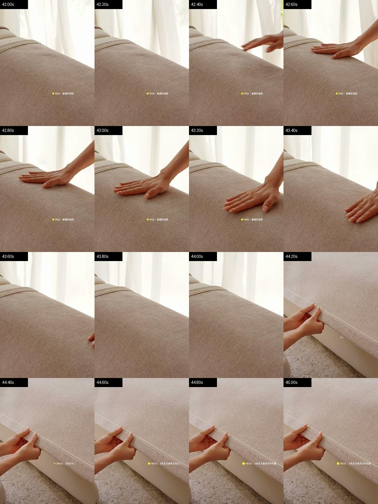
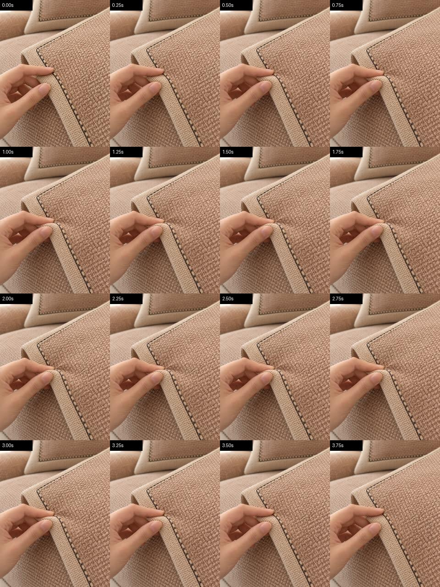

# 禾沐-米咖首镜修订：沿包边自然顺抚

版本：v1.1，2026-10-21更新；原设计日期2026-10-16。项目：`sofa-cushion-p1a-v1`。

**当前状态：已执行一次生成，结果待返工；完整成片未替换。** 用户已批准动作参考及追加10元／一次生成／零自动重试。以下第1–11节保留原设计与验收目标，不能当作已实现结果；授权、实际输入、生成结果与检查缺口见第12节。

## 1. 本次修订依据

现有完整候选为 `renders/sofa-complete-no-model-v1.mp4`，12秒，结构为包边→实铺→背面→品牌收尾。用户指出首镜手按压/轻捏沙发垫不真实，像慢镜头。本次只修订首镜及与实铺镜头相接的转场。

当前首镜使用 `assets/video/sofa-full-C-v1.mp4` 的0–2.5秒，源片834×1112、24fps、4.041667秒；Remotion的 `playbackRate=1`。慢感主要来自生成动作幅度小、长时间维持捏住状态，不能归因为剪辑降速。直接加速不作为本次修复方案。

自家天猫参考片 `inputs/reference/own-tmall-product-video-20260915.mp4` 为720×960、30fps、54.166667秒；SHA-256为 `8b4db227ed9a1ebc5c8983a10af8482b887d3547b964e33238921391dce9b7ff`。

| 原片时间 | 已观察动作 | 本次用途 |
|---|---|---|
| 9.4–11.2秒 | 手掌沿靠背垫上沿滑过并离手 | 辅助理解沿边路径；不把新镜头改成靠背抚摸 |
| 21.0–24.5秒 | 手掌抚过抱枕 | 不选作本次座垫动作锚 |
| **42.2–44.0秒** | **手掌入画、贴座垫、单程抚过、离画** | **主要动作锚** |

关键观察：约42.4秒手开始入画，42.6秒接触座面，42.8–43.6秒单程滑过，43.8秒手已离画。为符合当前视频引用至少2秒的接口约束，后续拟截取 **42.00–44.00秒**，不包含约44.2秒后的拉扯镜头。以上来自加密抽帧，关键段间隔0.2秒，未冒充完整实时回放；正式截取前仍需连续播放确认切点。

外部搜索也打开了[丁丁布艺的沙发垫展示候选](https://www.douyin.com/video/7690347781495524671)，可见手掌贴垫近景，未完成完整动作核验。本轮已经找到自家参考，因此不以该候选替代已核片段。

## 2. 镜头的一句话定义

**一只成年人的右手，在已实铺的禾沐-米咖座垫水平座面前沿，用正常生活速度、沿与下方真实包边平行的方向顺抚一次，然后离开，让无遮挡的织纹、前缘弯折和前裙下缘包边留在画面中。**

“沿包边顺抚”在本稿中指**运动方向沿边平行**，不是手掌跨到垂直前裙上揉搓走线。真实主图的深色前沿走线位于前裙下缘；座面转向前裙的弯折处不得新增第二道接缝或黑线。

镜头目的：用完整、自然的手与织物接触，引导观众看到包边及相邻织纹。可见结果是“顺抚结束后细节清楚可见”，不承担柔软度、回弹、耐磨或防滑的实测证明。

## 3. 动作作用的商品：具体是什么、在哪里

| 字段 | 本次锁定描述 |
|---|---|
| 商品身份 | 商品ID `944187614013`，销售选项“禾沐-米咖”；具体尺寸仍待选，不补写尺寸数字 |
| 当前被触摸部位 | **座垫朝上的水平织纹表面，靠近座面向前裙弯折的位置**；手沿下方真实包边的平行方向移动 |
| 铺设状态 | 座垫已自然平铺在正常成人尺度的奶油色沙发座面上，由沙发承托；前缘自然转向前垂区域 |
| 颜色 | 以该SKU真实主图为准的暖米咖色，不迁移参考视频的浅灰/奶白商品颜色 |
| 表面 | 规则、直线经纬交织的织纹，密度和外观参照真实商品图；不生成花卉、云纹、卷草或光滑绒面 |
| 边缘 | 前裙下缘的米咖包边和细窄深色走线参照商品图，镜头同时保留；**深色走线不能变成宽厚黑布条，座面弯折处不能凭空再加一条线** |
| 不被触摸的区域 | 靠背、扶手、前缘垂直挂下的前裙、背面颗粒，以及被拿在手里的折叠垫 |
| 不设定的参数 | 面料成分、实物厚度、弹性等级、克重和销售尺寸；本镜头无需这些未确认数值 |

事实依据：`artifacts/fact_snapshot_hemu_mika.v1.json` 中的 `SOFA-C02`（可见织纹）与 `SOFA-C03`（可见包边和深色走线）。主图支持观察这些细节，不证明“包边永不开线”“柔软度已验证”“不滑”“更耐磨”等结论。

## 4. 人物与身体连接

以下为创作默认，并非商品事实或真人身份声明：

- 设定一位成年女性做示范，**只露一只右手、手腕和相连前臂**；不出现脸、头发、躯干或全身。
- 素白、无图案的衬衫袖口挽至前臂；自然肤色，短指甲，无戒指、手表或夸张美甲。具体年龄和真实身份不锁定。
- 右手与座垫处于同一接触深度。前臂从画面右侧自然延伸进来，手腕与手掌保持连接；不出现前景巨手、悬空手、额外手或手指。
- 五指自然放松，掌面接近铺平。允许真实透视下的局部遮挡，不要求每一帧同时看见所有手指。
- 不复刻原视频模特的脸或身份，也不需要把此前无人物的实铺、收尾镜头改回人物镜头。

## 5. 五方面镜头描述

| 方面 | 具体设计 |
|---|---|
| 主体 Subject | 一只成年女性的右手及相连前臂；主要商品为已铺好的禾沐-米咖座垫前沿 |
| 主体动作 Subject Motion | 接触水平座面前沿→沿下方真实包边的平行方向单次顺抚→自然抬手离开；不捏、不抓、不抬垫、不反复揉搓 |
| 场景 Scene | 自然日光客厅，奶油色沙发。前缘、座面与承托关系可辨；无抱枕、杯子或其他物体遮挡动作。原始视频不含文字、LOGO或声音 |
| 空间构图 Spatial Framing | 手部、水平座面、连续前缘弯折和前裙下缘的真实包边同时入镜的近景，不用极端微距。包边横贯画面中下部、略呈左下至右上的斜线；右手在上方座面由右上侧向左下侧平行移动，全部关键动作留在9:16画面内 |
| 摄影 Camera | 固定机位，从沙发前方略俯拍，俯角约35°作为创作设定；自然透视、正常速度1倍，不推近、不变焦、不升格、不切镜；适度景深保证手掌接触、织纹和下缘走线都清楚 |

动作尺度使用相对描述：顺抚距离约一个半掌宽，短促但完整。这是动作设计，不是商品尺寸测量；不能用镜头透视反推实物尺寸。

## 6. 首镜的逐阶段时序

以下是**待生成目标**，不是现有素材已完成的动作。

| 输出时间 | 人物动作 | 商品响应与可见结果 |
|---|---|---|
| 0.00–0.20秒 | 右手已经开始入画，掌面自然落在靠近前缘弯折的水平座面上 | 接触点和接触阴影可见；首帧有清楚的动作前势，不先空等 |
| 0.20–1.20秒 | 手掌贴着面料，沿下方包边的平行方向从右向左单程顺抚约一个半掌宽 | 局部织物随接触有轻微自然变化，座垫整体仍受承托、保持落位；不出现深坑、果冻回弹或整块漂移 |
| 1.20–1.50秒 | 手自然抬离并退出动作区，手指保持连续正常形状 | 不抓起布边，不把座垫掀成直立或悬空状态 |
| 1.50–2.50秒 | 手已离开关键商品区域 | 至少1秒无遮挡展示：规则织纹、米咖包边及细窄深色走线清楚可见 |
| 2.50–4.00秒（源片余量） | 不再重复动作，机位稳定 | 商品保持同一结构和外观，给转场提供余量；这段不整体剪入成片 |

口播仍为“**别只看颜色，近看这道包边。**”现有TTS约0.235–2.275秒覆盖该句；“包边”落在动作完成后的清晰结果画面上。不得为了凑词强行慢放手部。

## 7. 参考素材分工

表内路径均相对于 `projects/sofa-cushion-p1a-v1/`。提交前绑定实际版本、哈希和外传授权。

| 素材 | 负责什么 | 不继承什么 |
|---|---|---|
| `inputs/reference/own-tmall-product-video-20260915.mp4`，拟用42.00–44.00秒 | 正常速度的接触、平移、离手节奏；单程手掌抚摸的物理关系 | 另一颜色商品像素、原片TIPS文字、整段原片的舒缓剪辑节奏、模特真实身份；原片抚摸座面，本次沿包边路径属于创作适配 |
| `inputs/source/hemu-mika-main-composite.jpg` | **真实商品事实锚**：禾沐-米咖颜色、编织外观、边缘和铺设关系 | 原图促销字、拼图布局、杯子等无关道具 |
| `assets/images/hemu-mika-weave-reference-v1.png` | 已有派生清理/生成图，仅辅助锁定织纹、米咖色和细窄深色走线 | **不复制其中的捏握姿势、拿起的曲面垫、前景手指和商品悬空关系**；不能把该图标成原始实物证据 |
| 现有无人物全貌图/源片 | 必要时辅助理解正常沙发尺度和已实铺关系 | 不替代真实主图的商品身份依据，不给微距动作增加第二个人或多只手 |

原设计拟采用 `reference_to_video`，将自家裁片作为连续动作参考、商品图作为外观参考，明确生成一个新的平铺座面近景。视频输入要求可读取的远程地址；不能将本地路径或普通Files ID冒充视频URL。执行时上传能力已在独立研发分支验证并集成，但本账户Files查询未返回可核验URL；随后使用实拍裁片的三张动作关键帧作图像参考，实际方法和局限见第12节，未改为纯文字猜动作。

## 8. 中文生成描述草案

> 生成一段新的4秒、9:16竖屏、720p真实家居商品摄影视频，固定机位，从正常尺寸奶油色沙发前方以约35度俯角拍摄座垫前沿近景，全程正常生活速度、连续拍摄、不切镜、不推近、不变焦。商品为已自然平铺并受沙发承托的禾沐-米咖座垫，触摸区域是朝上的水平座面、靠近座面向前裙弯折的位置，不是靠背、垂直前裙或拿在手中的折叠垫。严格按商品图保留暖米咖色、规则直线经纬织纹，以及前裙下缘的米咖包边和细窄深色走线，不能生成宽厚黑边、花卉、云纹、卷草或光滑绒面；座面向前裙弯折处不得新增接缝或走线。画面同时包含水平座面、连续前缘弯折和前裙下缘真实包边，不用极端微距。真实包边在画面中下部从左下向右上略斜延伸，织纹与走线清楚可辨。
>
> 示范者设定为成年女性，只露一只正常比例的右手、手腕及相连前臂，素白无图案衬衫袖口挽至前臂，自然肤色、短指甲、无饰物，不露脸、不出现躯干或第二只手，不复制真实模特身份。0至0.2秒右手从右侧自然接触靠近前缘弯折的水平座面；0.2至1.2秒掌面贴着面料，沿下方真实包边的平行方向从右上向左下单程顺抚约一个半掌宽；1.2至1.5秒自然抬手离开关键商品区域；1.5至4秒不重复动作，保留无遮挡织纹、前缘弯折及下缘包边。动作参考视频只提供接触、滑动和离手节奏，不能继承其商品颜色或文字；织纹图片只提供外观，不能继承其中捏住、抬起垫子的姿势。
>
> 保持手腕连接、自然手指形状及连续接触阴影。接触时只允许局部轻微自然变化，不反复揉搓、不捏握、不抓起布边、不夸张压陷、不果冻回弹、不让整块座垫移动或漂浮。自然日光、适度景深，手掌、织纹、下缘走线和接触处均清楚；无额外道具、文字、LOGO、水印和原生声音，不做任何性能测试演示。

## 9. Equivalent English generation description

> Generate a NEW 4-second, vertical 9:16, 720p photorealistic home-product video. Use a locked camera looking down at approximately35degrees from in front of a normal adult-size cream sofa, showing a close view of the installed seat pad's front edge. Record one continuous shot at ordinary real-time speed, with no cuts, push-in or zoom. The product is the Hemu-Mika beige-coffee seat pad lying naturally flat and supported by the sofa. The contact surface is the upward-facing horizontal seat surface near its continuous bend into the front drape, never the backrest, vertical hanging front drape or a folded pad held in the hand. Match the product images exactly for warm beige-coffee color, regular straight warp-and-weft weave, and beige-coffee binding with fine narrow dark stitching at the LOWER OUTER EDGE of the front drape. Never create a thick black border, flowers, cloud motifs, scrolls or smooth velvet; never add a new seam or stitching at the seat-to-drape bend. Include the horizontal seat surface, its continuous front bend and the true lower binding together, rather than using an extreme macro. The true binding runs slightly diagonally from lower-left toward upper-right across the lower-middle of the frame; both weave and stitching are clearly recognizable.
>
> The creative demonstrator is an adult woman; show ONLY one normally proportioned right hand, connected wrist and forearm. A plain white unpatterned shirt sleeve is rolled to the forearm. Use natural skin, short nails and no jewelry. Show no face, torso or second hand, and do not reproduce a real model's identity. At0–0.2seconds the right hand naturally contacts the horizontal seat surface near its front bend from the right. At0.2–1.2seconds the palm maintains contact and makes ONE smooth pass parallel to the true lower binding, from upper-right toward lower-left, over about one and a half palm widths. At1.2–1.5seconds naturally lift the hand away from the critical product region. At1.5–4seconds do not repeat the action; leave the weave, front bend and lower binding unobstructed. The reference video supplies ONLY contact, sliding and release timing, never its product color or text. The weave image supplies ONLY product appearance, never its pinching pose or lifted-pad geometry.
>
> Preserve the wrist connection, natural finger shapes and continuous contact shadows. Allow only small local changes caused by contact. No repeated rubbing, pinching, grabbing or lifting the edge, exaggerated indentation, jelly-like rebound, whole-pad sliding or floating. Use natural daylight and sufficient depth of field to keep the palm, weave, lower-edge stitching and contact region all clearly visible. No added props, text, logo, watermark or native audio. Do not depict a performance test.

## 10. 品牌、时间轴与冻结边界

- 保留已批准的PLAYBOY官方LOGO、Noto Sans CJK SC替代字体和当前版式；左上“包边”、64px、x72/y96，等宽蓝色下划线8px/间距22px；下方口播字幕38px，沿用现有位置和安全区。生成原片不烘焙品牌层。
- 全片仍为12秒、1080×1920、30fps、H.264/AAC。保留原Doubao口播和已批准SUNO混音，不重做TTS，不在新镜头内添加另一条音轨。
- 主体首镜为第0–74帧、2.5秒。现有转场会让C额外延长5帧承托A的淡入，因此允许变化的视觉区间是 **[0,80)帧，即0–2.666667秒**；第80帧起冻结。不是“2.5秒后全部像素都冻结”。
- A/B/D的源片、剪入区间、起始时间和后续标题字幕时间轴保持原版。冻结验证比较时间轴/素材/品牌依赖及画面内容，允许H.264再次编码造成的轻微像素误差，不要求MP4字节或解码RGB逐像素相同；需要精确画面比较时使用编码前的无损帧。
- 先提交3秒动态预览：2.5秒新动作及0.5秒原实铺接缝。通过后才制作完整替换版；预览审批不自动批准完整片。保留旧片、旧失败和原审核记录。

## 11. 后续生成与验收卡

拟继续 `cinematic-fast` 主线、`seedance_ark`、火山方舟 `doubao-seedance-2-5-260628` / `model_variant=2.5`，新源片4秒、9:16、720p、无原生音频。执行前先做参数、媒体引用、实际计费下限和预算预检；若提供方将请求判为编辑并要求自动时长，不自行改为 `duration=-1` 或改变画幅追加请求，应记录失败并重新核算。

原预算建议为**新增上限10元、一次生成、零自动重试**，随后已获用户批准并在原父预算下追加预占，未通过新镜头编号清空历史金额或次数。批准前保守目录估算59.1322元、8次付费尝试的历史基线保留；该目录估算与原生账本承诺分别记录，不相互冒充。本次已用完唯一生成机会，结果与费用状态见第12节。若未来恢复连续视频输入，最低计费不能只按“2秒输入+4秒输出”推断，[规则见官方价格页](https://docs.volcengine.com/docs/ark/model-pricing?lang=zh)。费用未知不填零。

| 验收项 | 方法与通过条件 |
|---|---|
| 商品身份 | 对照真实主图及事实卡；米咖色、规则织纹、细窄深色走线保持，没有换款或错误花纹 |
| 接触部位 | 连续回放可见水平座面由沙发承托；手在靠近前缘弯折的水平座面平行于下缘包边移动，不摸靠背、前裙或悬空垫；弯折处没有新增走线 |
| 动作完整与速度 | 以1倍连续播放完整源片及3秒预览；单次顺抚、约1.5秒前离开关键区，正常速度，没有慢动作、停顿或重复 |
| 手与布的关系 | 连续回放确认接触、滑行、离开合理；抽帧辅助检查手腕、手指、阴影、织纹和边缘 |
| 可见结果 | 1.5–2.5秒包边和相邻织纹无遮挡且可读；口播中的“包边”有明确画面对象 |
| 转场与冻结 | 无黑闪；五帧接缝自然；第80帧起主体时间轴/素材/品牌依赖保持，完整音频沿用原混音 |
| 版本与检查状态 | 新源片、预览、完整片各自绑定媒体哈希和审核；保留 `pass/fail/not_run/error`，不继承旧审批或以抽帧替代完整动作核验 |

上述验收目标没有因为已生成一次而降低。当前12秒候选仍可供对照，不因本文件更新而被覆盖或视为最终通过。

## 12. 执行记录与当前放行结论（2026-10-21）

- **工程接入：**自有实拍来源与裁片区间校验、同账户TOS上传、方舟Files上传及恢复、Seedance 2.5显式 `omni_reference_task_type=reference` 已在独立分支完成契约测试与复核，再集成到主干。接口与边界见[实拍参考入池与上传](owned-reference-video-ingestion.md)。
- **真实参考输入：**自家实拍42–44秒裁片经本地抽帧，使用相对裁片0.6／1.0／1.8秒的接触、滑行和离手关键帧，与商品织纹及无人物全貌两张参考图共同输入。方舟Files上传文件为active，但实际查询没有 `download_url`；未使用TOS上传，也未将Files ID拼成视频素材ID。本次为图像条件下的新动态生成，不是连续视频动作迁移。
- **生成与次数：**注册工具 `seedance_ark`，火山方舟 `doubao-seedance-2-5-260628`、`model_variant=2.5`、`reference_to_video`，4秒／720p／9:16／无原生声音。任务成功产出 `assets/video/sofa-full-C-edge-stroke-v4.mp4`，实际4.041667秒、720×1280、24fps。已使用一次批准机会；没有追加付费重试。
- **商品与动作问题：**九张抽帧及两次代理观察发现手与沙发尺度较之前合理，但米咖包边和深色走线被生成在水平座面中部，真实下缘结构没有保住；原片约2.8秒才离手。取0.625秒开始剪入2.5秒首镜后，离手展示余量仍不足原目标。商品身份和规定时窗内的可见结果均为 `fail`。抽帧观察不等于完整实时回放或语义认证。
- **实际预览：**原计划仍是“2.5秒新动作＋0.5秒实铺接缝”的品牌预览，但该合成的品牌预检被阻断，未导出品牌版。实际只从源片0.625–3.625秒导出3秒、1倍速度、无声、无品牌层的动作诊断片 `renders/sofa-edge-stroke-v4-action-diagnostic-3s.mp4`；已通过解码及3秒时长检查。它用于看动作，不冒充已批准的品牌样片，也未登记为正式成片审核。
- **检查与费用：**商品身份、结果时点保留失败；独立ASR、video_judge和连续运动认证均 `not_run`。视频API目录估算为6.111元，实际结算为未知；成功但淘汰的素材仍保留用量与费用，不能填零或释放历史成本。
- **当前放行：**`rework_required`，`certification_eligible=false`；原完整片、声音和审核记录不变，不能继承旧批准，也不能计入批量交付。先取得用户对诊断结果的反馈；额外生成需要新的明确授权。

版本化依据均相对于项目目录：`artifacts/planning/full-film-v4-edge-stroke/execution-authorization.json`、`artifacts/planning/full-film-v4-edge-stroke/reference-input-method.json`、`artifacts/planning/full-film-v4-edge-stroke/diagnostic-preview/action-diagnostic-summary.json`，以及 `artifacts/shot_sources/full-C/edge-stroke-v4-keyframes/` 中的计划、回执和源片观察。运行记录与签名链接留在受控项目数据中，不随设计文档提交。
