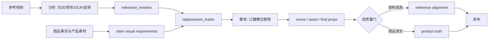

# Reference Fidelity 主线升级实施方案

> **定位更新（2026-09-13）：** 本文描述的是当前已落地的“爆款复刻 / 结构严格复刻”链路：参考片始终为 `analysis_only`，不得进入成片。更严格、允许授权参考片作为母版并对遮罩外像素做硬锁定的新链路，见 [`2026-09-13-licensed-master-clone-mainline.md`](2026-09-13-licensed-master-clone-mainline.md)。两条链路并存，后者不会放宽或改写本文的版权隔离规则。

> 状态：待实施评审
> 适用：`cinematic-fast` 主线；新增 `reference_fidelity` 输入模式
> 样本：`douyin-7670014963255151913.mp4`（参考原片）与 `depth-video-clone.mp4`（当前复刻片）
> 目标：保留参考片的叙事结构、镜头顺序、节奏、口播槽位和字幕节拍；只替换为本商品、可核验的产品事实、产品画面、卖点与品牌信息。

## 1. 决策与边界

本方案不是新建一条旁路，而是在 `cinematic-fast` 的 canonical mainline 上增加一个严格对齐的输入模式。生产仍走：

```text
research -> proposal -> script -> scene_plan -> assets -> edit -> compose
-> sample -> final_qa -> L1a -> publish
```

`reference_fidelity` 的“严格”只约束可量化的结构和时间关系，不复制受保护的表达元素：

| 保留（锁定） | 替换（必须重建） | 禁止进入成片 |
|---|---|---|
| beat 顺序、镜头顺序、镜头时长、切点、口播槽位、停顿、字幕出现时机、转场意图 | 产品身份、产品画面、卖点、口播文字、屏幕文案、品牌、logo、配色、音乐 | 原片像素、原片品牌/logo/水印、原片人物身份、原字幕文字、原音乐 |

参考片只可作为 `analysis_only` 输入。它不得被写入 `asset_manifest`、`final_props` 的渲染资产，或以裁切、遮罩、抠像等方式进入最终画面。

## 2. 模式差异

| 维度 | 当前 `reference_driven` | 当前 `source_led` / `source_led_template` | 新增 `reference_fidelity` |
|---|---|---|---|
| 参考视频角色 | 创意、结构、风格依据 | 无外部参考；模板提供先验 | 可执行的时间轴合同 |
| 叙事与镜头 | 可重组、可改编 | 由商品事实和模板决定 | 逐镜映射，不改变 beat/镜头顺序 |
| 口播 | 基于参考重新创作 | 商品事实重写 | 保留口播槽位、语速和停顿，重写文字 |
| 时间控制 | 整片级目标 | 模板节奏 | 每镜、每段口播、字幕均有 drift 阈值 |
| 素材选择 | 创意优先 | 证据矩阵优先 | reference shot -> claim -> evidence -> target shot 闭环 |
| 审核重点 | 风格和商品事实 | 商品事实与证据 | 结构保真 + 商品真实，两套独立硬门 |



## 3. 当前样片评估与目标

对所给的两条样片，当前复刻工具已经实现了“结构复刻”的雏形：它保留了原片的短视频促销语法、快速切换和卖点推进，因此用户感受到的是同一条内容骨架。主要缺口在于它把“像”主要做在成片视觉上，尚未把每个镜头、口播和商品证据变成可校验的合同。

| 维度 | 当前判断 | 主要风险 | 主线改造目标 |
|---|---|---|---|
| 结构/镜头序列 | 较好，约 8.8/10 | 不能解释每个镜头为何这样替换 | `reference_shot_id` 逐镜闭环 |
| 卖点映射 | 中等，约 7.2/10 | 画面、口播和事实未必一一对应 | claim -> evidence -> shot 矩阵 |
| 节奏与技术同步 | 中等，约 6.8/10 | 当前样片约 12.042s，原片约 12.434s，约 -392ms；原片 30fps，复刻片 24fps | 统一 30fps；整片 drift <= 120ms |
| 口播/字幕 | 节奏相近但无段级合同 | 新文案变长后会挤压节拍，字幕可能漂移 | 段级 TTS timing lock 与字幕联动 |
| 商品真实 | 取决于人工输入 | 高风险功效可能被视觉“演示”误证明 | 事实等级和证据硬门 |

音频基线：原片约 -13 LUFS，复刻片约 -15.5 LUFS。响度不应照抄原片，而应对齐平台 profile；差异必须记录、可审核。

### 3.1 该工具的复刻手法推断

从结果看，它更接近“参考视频的视觉节奏 + AI 重生成/重剪”的黑盒流水线：先吸收原片的分镜、动作类型、字幕密度与声画节拍，再用产品图和卖点生成替代镜头，并把新口播贴回近似的时长中。这种方法的优点是快、第一眼相似；弱点是没有显式的逐镜血缘、事实证明与容差控制，因此面对卖点变长、缺少真实演示素材或多 SKU 时容易失真。

要超过它，OpenMontage 不应追求直接复用原片，而应把它的隐性能力显式化为三个可审计制品：`reference_timeline`、`replacement_matrix` 和 `voice_alignment_report`。

## 4. 商品卖点的事实与画面合同

本次产品的五个卖点不能只作为生成 prompt。它们必须先编译为 `claim_visual_requirements`：

| 卖点 | 可用口径 | 必须的事实来源 | 最低画面证据 | 不能用作证明 |
|---|---|---|---|---|
| 实厚，不虚标 | 有清晰规格/实测时可用 | 参数页或测量记录 | 卡尺或截面测厚，读数清晰 | 仅拍边缘显厚 |
| 纯净原材料，透度高 | “纯净”需授权口径 | 材质事实；“透度”可由画面观察 | 透光、底纹清晰、边缘对比 | 生成画面代替材料证明 |
| 久用不发黄，质保 2 年 | 需质保与适用 SKU | 商品页/质保凭证/报告 | 可呈现质保承诺；耐黄变需对应报告 | 短时画面证明“久用” |
| 无味，安全 | 需检测或商品页授权口径 | 检测报告/安全说明 | 可展示授权事实或检测凭证 | 人物闻一闻、生成“无味”场景 |
| 防油渗透 960 小时 | 高风险，必须有报告 | 报告正文与适用 SKU | 报告/授权事实；泼油擦拭仅可证明当下表现 | 单次泼油证明 960 小时 |

当事实或可见证据不足时，矩阵行必须是 `omit` 或 `awaiting_human`，不能让生成视频承担事实证明职责。

## 5. 新增 Canonical Artifacts

### 5.1 `fidelity_policy.json`

```json
{
  "version": "1.0",
  "mode": "reference_fidelity",
  "locked_dimensions": ["beat_order", "shot_order", "shot_duration", "cut_points", "voice_cadence", "pause_structure", "caption_timing", "transition_intent"],
  "replaceable_dimensions": ["product_identity", "product_claims", "visual_evidence", "narration_words", "screen_copy", "logo", "brand_colors", "music"],
  "forbidden_dimensions": ["reference_brand", "reference_logo", "reference_watermark", "reference_person_identity", "reference_original_pixels", "reference_caption_text"],
  "duration_drift_tolerance_ms": 120,
  "voice_timing_tolerance_ms": 160
}
```

### 5.2 `reference_timeline.json`

参考分析输出真实 FPS、分辨率、时长、镜头切点、关键帧、转写、音频停顿和字幕位置。每镜至少包含：

```json
{
  "reference_shot_id": "ref-shot-01",
  "start_seconds": 0.0,
  "end_seconds_exclusive": 1.35,
  "beat_role": "hook",
  "visual_mechanism": "hand_touching_product_edge",
  "shot_size": "close_up",
  "camera_movement": "dolly_in",
  "transition_intent": "impact",
  "caption_interval": {"start_seconds": 0.48, "end_seconds": 1.27},
  "narration_interval": {"start_seconds": 0.18, "end_seconds": 1.25}
}
```

### 5.3 `replacement_matrix.json`

它是严格复刻的核心制品。一行必须闭合下面的键控链路，禁止通过数组位置配对：

```text
reference shot -> product fact -> claim visual requirement -> source/generated asset
-> source interval -> target shot -> final evaluation
```

```json
{
  "reference_shot_id": "ref-shot-01",
  "target_scene_id": "scene-01",
  "target_shot_id": "shot-01",
  "claim_ids": ["claim-real-thickness"],
  "product_fact_refs": ["product_facts.claims[0]"],
  "visual_route": "owned_source",
  "source_path": "inputs/source/thickness-measure.mp4",
  "source_interval": {"start_seconds": 1.2, "end_seconds_exclusive": 2.5},
  "required_action": "caliper_measurement",
  "required_result": "visible_thickness_reading",
  "alignment_status": "pending"
}
```

### 5.4 对其他制品的扩展

- `script.section` 新增 `reference_shot_id`、reference narration interval、`voice_performance`、`evidence_row_ids`。
- `scene_plan.scene` 新增 reference/target interval、`duration_drift_ms`、`reference_mechanism` 与 `evidence_row_ids`。
- `final_props.json` 写入三种上游 hash、reference profile 和最终 drift。
- 新增 `voice_alignment_report.json` 与 `reference_alignment_report.json`，让回修定位到具体镜头或口播段。

## 6. 阶段改造

### Research：把参考片转成时间轴合同

并行调用 `ffprobe`、`scene_detect`、`frame_sampler`、`transcriber`、`audio_energy` 与 OCR，产出 `reference_fingerprint.json`、`reference_timeline.json`、`caption_style_fingerprint.json`。每个镜头按既有五维分析法记录 Subject、Subject Motion、Scene、Spatial Framing、Camera；字幕与水印作为独立 overlay 层记录。

### Script：生成口播槽位替换稿

脚本不再生成“相似文案”，而是填充固定的 reference narration interval。每段必须：只使用允许的产品事实；可以在目标 interval 内念完；有对应的 claim 和 evidence row；且不得复制参考原文案。无法对齐时按以下顺序回修：调整 TTS 语速/停顿 -> 调整段间空隙 -> 重写该段文案；禁止整片粗暴加速。

### Scene/Assets：替换机制，而非模糊相似

每个 target shot 必须唯一绑定 `reference_shot_id`，目标起止时间默认与参考相同。素材路由继续采用 `owned_source | generated_from_product_image | omit`；生成资产仅可表达经确认的事实，不能写入证据字段。参考视频路径不得出现于 render 输入。

### Compose：统一节奏与输出 profile

两个 composition runtime 都要消费同一份 `final_props`，支持固定切点、分段 TTS、字幕区间和逐镜 metadata。若参考片为 30fps，目标默认输出 30fps；任何 24fps 生成素材都在 compose 时规范化，不能改变成片 FPS。

## 7. 质量门与发布标准

`reference_alignment_report` 分成两类分数，避免“拍得像”掩盖商品失真：

| 评分组 | 维度 | 发布要求 |
|---|---|---|
| Reference Fidelity | beat/shot order、镜头时长、切点、镜头语法、字幕时间、口播时间、转场意图 | overall >= 0.85；结构/镜头顺序 >= 0.95 |
| Product Truth | 商品身份、claim/evidence、口播/花字事实、SKU、视觉证据完整性、生成媒体角色 | overall >= 0.95；商品身份 = 100% |

以下任何一项都会阻断发布：高风险 claim 无证据；参考品牌、水印、原字幕残留；整片时长 drift > 120ms；口播分段起止 drift > 160ms；字幕与口播文本不一致；商品身份漂移；`omit` 行进入已批准脚本。

首版 Beta 目标：结构/镜头顺序匹配 >= 95%，镜头时长误差中位数 <= 120ms，字幕口播对应正确率 >= 95%，所有卖点有事实来源，所有可见功效有证据或明确 `omit`。相对当前样片，目标为结构保真 >= 9.3/10、卖点映射 >= 9.0/10、技术同步 >= 9.0/10。

## 8. Backlot 工作台

新增“参考复刻”视图，按 `reference_shot_id` 并排展示：参考关键帧、目标关键帧、原片/目标的口播与字幕时间、产品事实、证据素材、drift 和对齐状态。人工可调整 target shot 起止、替换文案/素材、选择事实、标记 `pass | revise | omit`，并仅重生成受影响的镜头。

工作台不得允许：直接把参考片作为最终素材；复制参考字幕；脱离 canonical artifact 修改成片；在不重开脚本审核的情况下改动已锁定产品事实。

## 9. 实施顺序

- [ ] **Phase 1: 合同和模式。** 增加 `reference_fidelity`、三份 schema、analysis-only 硬门和旧模式兼容测试。
- [ ] **Phase 2: 时间轴分析。** 实现 timeline builder，接入切点、关键帧、转写、音频统计和字幕 OCR，计算镜头/切点 drift。
- [ ] **Phase 3: 事实替换。** 扩展 Script/Scene 键控字段，生成 replacement matrix，接入 `product_facts.check_text_facts` 和文本长度预检。
- [ ] **Phase 4: 音频与素材对齐。** 实现分段 TTS timing lock、voice report、响度与采样率规范化、镜头级局部重跑。
- [ ] **Phase 5: 渲染与质量门。** 统一 FPS，写入 lineage hash，双评分与发布硬门接入 `final_qa` / `L1a`。
- [ ] **Phase 6: Backlot 与回归。** 实现逐镜对照、人工 revise/omit、完整 fixture 和端到端回归。

## 10. 测试计划

Contract tests 覆盖：新模式初始化、外部参考路径存在、旧模式不变、schema 必填字段、analysis-only 隔离、reference media 不得进入最终素材。

Unit tests 覆盖：镜头/切点/口播 drift、字幕口播对齐、reference shot 映射完整性、claim 与 evidence 一致性、生成素材不得充当事实证据。

Integration tests 使用本次两条视频 fixture，必须检测当前约 -392ms 时长 drift、30fps/24fps 不一致、响度差异，以及“字幕出现卖点但无视觉证据”的情况；并对五个产品卖点生成 evidence requirement，在缺证据时阻止发布。

Visual QA 检查实际输出尺寸、30fps、透明产品边缘稳定性、字幕不遮挡关键动作、测厚/透光/泼油等动作真实出现、参考品牌残留和生成商品形态漂移。

## 11. 关键实现原则

1. `final_props.json` 仍是唯一渲染时间轴；新增 artifact 只提供可验证输入，不能产生第二套时间轴。
2. 所有时间区间使用半开区间 `[start, end)`；单位和 FPS 显式记录。
3. 所有跨阶段关联使用 ID；任何位置索引关联一律拒绝。
4. 参考保真评分与产品真实评分必须独立发布，不能以平均分互相掩盖。
5. 样片阶段先验证结构、事实和声画对齐，再进入最终渲染；失败从最小受影响制品回修。

本方案的竞争力不在于“原片看起来更像”，而在于把现有工具隐性的复刻能力升级为可追溯、可回修、可批量交付且不牺牲商品真实性的正式主线。

---

# 详细实施计划

> **Goal:** 在现有 Backlot“新建复刻项目”入口中新增“严格复刻”模式，并将该模式接入 `cinematic-fast` 的现有阶段、checkpoint、artifact、审核和渲染主线。
>
> **Architecture:** 不新建 pipeline；扩展 `cinematic-fast` 的 `INPUT_MODES` 和 `mode_requirements`。前端负责显式选择模式与收集参考片/商品素材，后端在 `project.json` 固化模式合同；研究阶段产出参考时间轴，后续阶段通过 ID 绑定逐镜替换，最终由双质量门阻断不对齐或不真实的成片。
>
> **Tech Stack:** Python 3.10+、YAML pipeline manifest、JSON Schema、FFmpeg/ffprobe、现有 Backlot 原生 HTML/JavaScript、pytest/jsonschema。

## A. 文件职责与改造面

| 文件 | 改造内容 |
|---|---|
| `backlot/ui/index.html` | 新增模式选择区；“普通参考驱动”和“严格复刻”使用 radio/segmented control，严格模式展示锁定项和额外输入提示 |
| `backlot/ui/library.js` | 将 `input_mode`、严格复刻参数写入创建 payload；严格模式校验参考视频仅分析用途；创建后上传路径保持现有 API |
| `backlot/operator_routes.py` | 创建项目 API 接受并白名单校验 `input_mode`、`fidelity_policy`；拒绝 source-led 与外部参考冲突 |
| `lib/pipeline_loader.py` | `INPUT_MODES` 增加 `reference_fidelity`；增加模式归一化及 external reference 校验 |
| `lib/checkpoint.py` | `init_project`、checkpoint 读取和阶段门支持新模式；兼容旧项目默认 `reference_driven` |
| `pipeline_defs/cinematic-fast.yaml` | 增加 `reference_fidelity` mode requirements、产物列表、额外审核重点和严格模式 approval bundle |
| `schemas/pipelines/pipeline_manifest.schema.json` | mode requirements 增加新枚举键 |
| `schemas/checkpoints/checkpoint.schema.json` | `input_mode` 枚举增加 `reference_fidelity` |
| `schemas/artifacts/fidelity_policy.schema.json` | 新增锁定/可替换/禁止维度和容差契约 |
| `schemas/artifacts/reference_timeline.schema.json` | 新增参考镜头、字幕、口播和转场时间轴结构 |
| `schemas/artifacts/replacement_matrix.schema.json` | 新增 reference shot 到商品事实、证据素材、target shot 的闭环结构 |
| `schemas/artifacts/voice_alignment_report.schema.json` | 新增逐段 TTS 起止 drift、响度和采样率报告 |
| `schemas/artifacts/reference_alignment_report.schema.json` | 新增 Reference Fidelity/Product Truth 双评分与硬门结果 |
| `skills/pipelines/cinematic-fast/research-director.md` | 增加严格模式并行分析、时间轴构建和 analysis-only 规则 |
| `skills/pipelines/cinematic-fast/script-director.md` | 增加口播槽位替换、文案时长预算和 claim/evidence 引用规则 |
| `skills/pipelines/cinematic-fast/scene-director.md` | 增加逐镜 reference shot 映射和半开区间 drift 规则 |
| `skills/pipelines/cinematic-fast/asset-director.md` | 增加 replacement matrix 完整性、TTS timing lock 和生成素材事实边界 |
| `skills/pipelines/cinematic-fast/sample-director.md` | 增加 voice/reference alignment report 和严格模式样片硬门 |
| `skills/pipelines/cinematic-fast/compose-director.md` | 增加 FPS 规范化、timeline hash 和禁止参考片进入渲染输入 |
| `lib/reference_timeline.py` | 新增参考视频元数据、切点、口播、字幕指纹和 drift 计算；保持纯函数，供测试复用 |
| `lib/reference_fidelity.py` | 新增 policy/matrix/双评分校验，不承担创意决策 |
| `lib/voice_alignment.py` | 新增逐段音频时间对齐和容差判断 |
| `backlot/operator_state.py`、`backlot/ui/operator/app.js`、`backlot/ui/operator/approval.js` | 在审核工作台显示模式、锁定项、reference/target 对照、drift、claim 与证据状态 |
| `tests/contracts/test_reference_fidelity_contract.py` | 模式、manifest、checkpoint 和 analysis-only 合同测试 |
| `tests/lib/test_reference_timeline.py`、`test_reference_fidelity.py`、`test_voice_alignment.py` | 时间轴、矩阵、事实和音频对齐单元测试 |
| `tests/backlot/test_reference_fidelity_entry.py` | 创建入口 payload 与错误提示测试 |

## B. 分步执行任务

### Task 1：先锁定后端模式合同

- [ ] 在 `tests/contracts/test_reference_fidelity_contract.py` 先写失败测试：新模式可被 `load_pipeline` 接受；没有参考路径时创建失败；`usage != analysis_only` 时失败；source-led 带外部参考时失败；旧 checkpoint 仍按 `reference_driven` 读取。
- [ ] 在 `lib/pipeline_loader.py` 增加 `reference_fidelity`，复用 `_normalise_external_reference`，但对显式新模式强制要求至少一个可解析路径。
- [ ] 在 `lib/checkpoint.py` 的 `INPUT_MODES` 读取、`init_project` 和 marker 校验分支增加新模式；严格模式必须有 `external_reference`，不得设置 `template_prior` 作为替代参考。
- [ ] 在两个 schema 中加入新枚举，并为 `mode_requirements` 增加新键。
- [ ] 运行：`pytest tests/contracts/test_reference_fidelity_contract.py -q`，预期全绿；再运行既有 `pytest tests/lib/test_source_semantics.py tests/lib/test_checkpoint* -q`，确保旧模式无回归。

### Task 2：改造“新建复刻项目”入口

- [ ] 在 `backlot/ui/index.html` 的创建表单中加入 `name="input_mode"` 的二选一控件：`reference_driven`（默认）与 `reference_fidelity`（严格复刻）。严格模式旁显示“锁定镜头顺序/节奏/口播节拍，只替换商品与卖点”。
- [ ] 在 `library.js` 根据模式切换提示：严格模式要求恰好至少一个参考视频；仍要求自有素材或商品资产；版权确认 checkbox 继续必选。
- [ ] payload 增加：`input_mode`、`external_reference: {present, paths, usage: "analysis_only"}`、`fidelity_policy_ref: "artifacts/fidelity_policy.json"`。不要让前端直接提交可变的锁定阈值，阈值由后端版本化 policy 生成。
- [ ] 在 `operator_routes.py` 的 create project handler 中对 payload 做白名单校验并传给 `init_project`；错误信息区分“缺参考片”“缺自有素材”“模式冲突”。
- [ ] 在 `tests/backlot/test_reference_fidelity_entry.py` 覆盖：选择严格模式提交成功；缺参考片 400；普通模式 payload 不新增强制字段；路径重复上传仍幂等。
- [ ] 浏览器验收：打开 `/`，选择严格复刻，上传一条参考片和一个自有素材目录，确认创建后的 `project.json` 写入模式和 analysis-only。

### Task 3：扩展 `cinematic-fast` manifest 和阶段输入输出

- [ ] 在 `pipeline_defs/cinematic-fast.yaml` 的 `mode_requirements` 增加：

```yaml
  reference_fidelity:
    research_required_tools: [video_analyzer, scene_detect, frame_sampler, transcriber, audio_energy]
    research_required: [research_brief, video_analysis_brief, reference_fingerprint, reference_timeline, fidelity_policy, caption_style_fingerprint]
    scene_plan_required: [script, creative_control_plan, reference_timeline, replacement_matrix, reference_source_matrix]
    research_produces: [research_brief, video_analysis_brief, reference_fingerprint, reference_timeline, fidelity_policy, caption_style_fingerprint]
```

- [ ] `research`、`script`、`scene_plan`、`assets`、`sample`、`compose` 的 `produces`/`required_artifacts_in` 增加严格模式制品；不修改静态 legacy stage contract 的默认行为。
- [ ] 将 `reference_timeline`、`replacement_matrix`、`voice_alignment_report`、`reference_alignment_report` 纳入严格模式 approval bundle 的 required artifacts。
- [ ] 运行 pipeline manifest schema 校验和 `tests/contracts/test_pipeline_manifests.py`。

### Task 4：实现参考时间轴 builder

- [ ] 先写 `tests/lib/test_reference_timeline.py`：半开区间合法性、镜头排序、时长 drift、重叠区间、缺少 FPS、字幕/口播区间越界均有明确结果。
- [ ] 新增 `lib/reference_timeline.py`，输入为 ffprobe/scene detect/transcript/OCR/audio-energy 的结构化结果，输出 `reference_fingerprint`、`reference_timeline` 和 `caption_style_fingerprint`。
- [ ] 时间单位统一秒，区间统一 `[start_seconds, end_seconds_exclusive)`；原始帧号和 FPS 同时保存，避免 24/30fps 混淆。
- [ ] 研究 director 并行执行 ffprobe、切镜、抽帧、转写、音频能量和 OCR；参考文件只允许写入 research artifacts，不允许写入 asset manifest。
- [ ] 用两条样片 fixture 验证识别约 12.434s/30fps 与约 12.042s/24fps，并产出约 -392ms drift。

### Task 5：实现逐镜 replacement matrix 与脚本改造

- [ ] 先写失败测试：缺 `reference_shot_id`、重复 target shot、未解析 evidence row、claim 无 product fact、高风险 claim 无报告时均拒绝进入 approved script。
- [ ] 新增 schema 和 `lib/reference_fidelity.py` 校验器；所有关系使用 ID，不得按列表 index。
- [ ] Script director 将每个 reference shot 编译为一个 section，写入 `reference_narration_interval`、`voice_performance`、`claim_ids` 和 `evidence_row_ids`。
- [ ] 将五个卖点分别建立 claim requirement：测厚、透光、质保、检测/安全、960 小时报告；没有证据的行只能 `omit`/`awaiting_human`。
- [ ] Scene director 默认复制 reference interval 到 target interval，计算 `duration_drift_ms`，并验证动作证据窗覆盖口播开始时刻。

### Task 6：分段 TTS 与样片对齐

- [ ] 先写 `tests/lib/test_voice_alignment.py`：段起止 drift、字幕与口播差值、整片时长 drift、响度差异和采样率差异。
- [ ] 新增 `lib/voice_alignment.py`；优先调整 TTS 语速/停顿，其次段间空隙，最后重写文案；禁止整片加速。
- [ ] sample director 生成 `voice_alignment_report.json`，并在严格模式下要求整片 drift <=120ms、段起止 drift <=160ms、字幕/口播起点差 <=180ms。
- [ ] 任何口播或字幕修改都必须让 `render_plan` 标记受影响镜头和音频重新生成，不允许只替换最终 mp4。

### Task 7：Compose FPS 与双质量门

- [ ] 在 `final_props` 中写入 `reference_timeline_hash`、`replacement_matrix_hash`、`voice_alignment_hash`、`render_profile` 和 drift。
- [ ] compose director 明确要求：参考片 30fps 时目标输出 30fps；24fps 生成素材在 compose 阶段规范化；音频响度按平台 profile 归一化。
- [ ] `reference_alignment_report` 分为 Reference Fidelity 与 Product Truth 两组；前者 <0.85 或后者 <0.95 时阻断/回修，高风险 claim 无证据永远阻断。
- [ ] 在 `tests/integration/test_reference_fidelity_fixture.py` 验证当前两条视频会被识别为 FPS、时长、响度和视觉证据缺口问题。

### Task 8：Backlot 严格复刻审核视图

- [ ] `operator_state.py` 增加 `reference_fidelity` 投影：模式、reference shot 列表、target shot、claim、evidence、口播/字幕区间和 drift。
- [ ] `approval.js` 为严格模式增加逐镜对照卡：参考关键帧、目标关键帧、锁定状态、事实来源、证据素材、`pass/revise/omit`。
- [ ] 只允许对 target shot、文案、证据素材做编辑；修改锁定维度必须生成新的 decision log 并重新打开对应 approval group。
- [ ] UI 测试覆盖：严格模式标签可见、参考片没有“作为最终素材”的操作、drift 超阈值显示阻断原因。

## C. 发布前验收矩阵

| 验收项 | Beta 门槛 |
|---|---:|
| 入口创建成功率 | 严格模式 payload -> project marker 100% |
| 结构/镜头顺序 | >= 95% |
| 整片时长 drift | <= 120ms |
| 单段口播起止 drift | <= 160ms |
| 字幕与口播对应 | >= 95% |
| 商品身份匹配 | 100% |
| 高风险事实误用 | 0 |
| 参考品牌/水印/原字幕残留 | 0 |
| 卖点事实来源 | 5/5 有来源；无证据卖点明确 `omit` |

## D. 执行顺序与提交边界

建议拆成 6 个可独立回滚的提交：

1. `feat: add reference fidelity input contract`
2. `feat: add strict replication entry mode`
3. `feat: build reference timeline artifacts`
4. `feat: bind claims evidence and replacement matrix`
5. `feat: align voice and reference fidelity quality gates`
6. `feat: add strict replication Backlot review surface`

每个提交都必须先写失败测试、运行定向测试，再运行相关回归；不要在真实生产任务中临时开发工具或 schema。完成全部提交后，再用两条样片做一次只读 fixture 回放，确认旧 `reference_driven`、`source_led` 和 `source_led_template` 行为未改变。
