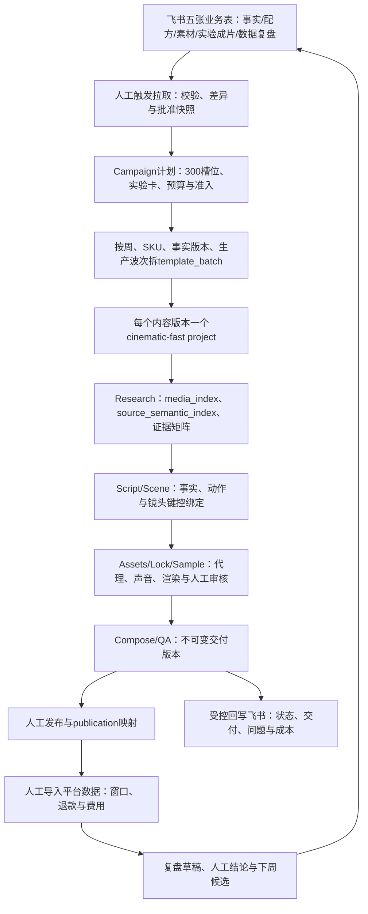

# 毛巾300条经营闭环：OpenMontage主线升级实施方案

> **For agentic workers:** 实施时使用 `superpowers:executing-plans`，逐任务完成和验证；需要使用子代理时遵循当时有效的授权规则。步骤以复选框跟踪。本文件是升级设计与实施计划，不是已实现能力说明。

**Goal:** 在现有实拍素材驱动的生产主线上，接通飞书业务台账、300条排产、商品事实与授权准入、交付追溯及人工导入经营数据的闭环。

**Architecture:** 以 `cinematic-fast / source_led_template` 为批量生产主路，由Agent依据manifest和技能驱动阶段；Python只承担确定性适配、校验、记录和事务。上层增加轻量campaign业务聚合，复用 `template_batch`、单片project、审批事务和不可变delivery version，不建设第二套渲染器、审批中心或自动投放系统。

**Tech Stack:** 现有Python/JSON Schema/ProjectCommitStore、飞书多维表格与lark-cli、Remotion/FFmpeg、现有Backlot操作界面、pytest。

**基线日期：** 2026-09-13。当前检出HEAD为 `b59e46e`。工作区已有大量未提交的主线改动，包括事务写入、source-led、字幕/声音对齐和reference-fidelity；本方案依据“HEAD＋当前工作区”只读核对，不宣称这些改动已合并、全部测试通过或生产验收完成。本轮只写方案文档，不改生产代码、不提交其他人的变更。

**业务依据：** `花花公子毛巾_300条_V2/04_业务与技术一体落地方案.md`。用户已选：业务与技术一体落地、轻量台账＋现有生产线、飞书、部分资源已有、样片实测预算。

---

## 1. 结论与架构定位

上一轮的通用hybrid建议替换为：**campaign经营约束 → 按SKU/事实快照分批 → source-led模板主线 → 审核交付 → 发布映射与经营回写**。素材缺口优先补拍。外部参考仅用于研究和结构借鉴，不能自动进入可商用素材库。



保留三个独立判断：事实/权利是否可用、创作/技术是否通过、经营证据是否成熟。视频成功渲染不等于允许发布；允许发布不等于已经获得经营验证。

## 2. 当前主线：复用什么，具体缺什么

| 子系统 | 已核对代码/契约 | 本次处理 |
|---|---|---|
| 输入模式与阶段 | `lib/pipeline_loader.py`、`pipeline_defs/cinematic-fast.yaml`支持 `reference_driven/reference_fidelity/source_led/source_led_template` | 使用 `source_led_template`，模板先验 `usage=structural_only`；不制造参考片，也不新增“毛巾专属”pipeline |
| 自有素材证据 | `lib/source_semantics.py`、`lib/template_mainline.py`已有语义索引、证据矩阵和明确slot绑定 | 前置业务授权、SKU及声明批准过滤；复用现有证据窗口 |
| 实拍文案生成 | `_source_led_copy`要求claim/action/allowed_wording齐全，适合证据镜头；现有通用输入尚不能视为已支持全部治愈/关系叙事 | 增加明确的镜头用途与已批准copy输入，防止生活镜头被强塞商品功效、开场变体被事实句重写 |
| 商品事实 | `lib/product_facts.py`与schema支持事实、claims、visual_identity；现有引用如 `product_facts.claims[0]` | 新增稳定业务声明ID到冻结快照位置的映射，保留旧引用格式 |
| 覆盖路由 | `lib/product_image_routing.py`含 `owned_source/generated_from_product_image/omit` | 本campaign商品事实镜头仅允许自有已核验源；生成仅可用于非商品事实辅助内容 |
| 模板批次 | `lib/template_batch.py`一模板一run、批次共享一份事实；区别于只选少数候选的candidate_batch | 按SKU与事实快照拆分；显式传run ID，解决同模板多变体和跨批重名 |
| 单片主线 | `lib/template_fork.py`、`lib/template_mainline.py`、`lib/template_assets.py`、`lib/template_render.py` | 接入业务引用，不另写逐阶段大脚本；fork复用已分析素材与真实run plan |
| 事务与审批 | `backlot/project_commit.py`、`project_write_sink.py`、`operator_reviews.py`、`batch_actions.py`已有generation/hash与事务边界 | 所有受管项目新增写入走sink；飞书不直接修改checkpoint、delivery或审批结果 |
| 交付版本 | `backlot/delivery_versions.py`已有不可变交付manifest和current pointer | 直接绑定 `(project_id, version_id, manifest_hash)`，不再发明另一个成片文件版本体系 |
| 经营外环 | 定向搜索未发现production级publication/performance/readout实现；增长报告也将其列为缺口 | 增加人工导入和可追溯数据对象；不把占位字段当已连接能力 |
| 批量执行 | 已有批次描述、状态、fork、批量审核；定向搜索未找到 `template_batch_runner` | v1由Agent分波次驱动，程序提供可恢复任务状态和预算检查；常驻自动调度不是首期前置 |
| 素材检索 | `lib/corpus.py`已有通用检索；本轮registry中clip_retrieval/corpus_population未配置 | v1用已核验语义索引和标签召回；不以新向量库或外部检索服务作为开工条件 |

历史架构报告中的“全部测试通过”、13.2候选/小时或低价批次，是特定历史试验记录，不能外推为本任务可达75条/周、事实合格率或工具预算承诺。

### 必须保留的架构边界

- Agent决定选题、研究解释、阶段推进与经营建议；程序执行已批准的确定性操作，不新建Python创意编排器。
- `template_batch`承担生产批次，experiment承担业务对照关系，campaign承担计划汇总；三者不是同一个对象。
- 一个生产批次只共享同一SKU、同一事实快照和适配研究资料；跨SKU素材不得通过共享Research误继承。
- `publish`阶段现有语义包含本地交付打包，不能据此标记“已在抖音发布”。
- Backlot仍负责技术/创作审核；飞书负责业务输入、事实批准和经营决策，避免形成两个审批真相源。
- 本次只针对campaign启用严格规则，不能让历史非campaign项目突然因缺业务字段而全部失效。
- 当前 `DeliveryVersionService.certify`主要校验manifest结构与 `qa.status=pass`；本次复用其不可变存储，不把调用方传入的pass视为充分审核证据。campaign认证入口还必须核对真实文件hash、业务门、适用的技术报告及真实人工评审版本。

## 3. 目标数据合同与版本规则

### 3.1 存储与所有权

campaign资料存于 `projects/<campaign-id>/`，以 `campaign.json`识别，首期不伪装成一个可渲染视频project，不出现在普通单片阶段列表。视频子项目仍通过现有 `init_project` / `fork_template_run`建立。

campaign根目录复用ProjectCommitStore的目录身份、版本事务与outbox；新增存储适配器统一入口并测试无 `project.json` 的campaign目录。不得为了写台账关闭子项目operator-managed约束。

```text
projects/<campaign-id>/
  campaign.json                       # 身份与campaign配置
  artifacts/campaign_plan.json         # 排期、配额、波次及修订
  artifacts/campaign_snapshot.json     # 批准的事实/配方/素材/实验快照及来源
  artifacts/campaign_delivery_index.json
  artifacts/publication_registry.json
  artifacts/experiment_readout.json
  artifacts/imports/<import-id>.json   # 导入manifest与规范化记录，保留历史
  inputs/imports/                     # 原始平台导出表；单独访问控制
  operator/                          # 复用事务代际、审计与回写outbox

projects/<run-project-id>/
  artifacts/campaign_content_link.json
  artifacts/campaign_gate_report.json
  artifacts/product_facts.json
  artifacts/<existing-mainline-artifacts>.json
  operator/delivery-versions/<version-id>/manifest.json
```

另为每个生产分片建立独立的现有批根project：`projects/<campaign-id>-wN-<sku>-waveN-bNNN/`，保存自身 `project.json`、`artifacts/template_batch.json`、`template_pack.json`、`differentiation_plan.json`、冻结product_facts及该SKU的共享Research。不可把多个SKU/波次的template_batch都覆盖到campaign根的同一个固定文件。子run的 `project.json.template_run.batch_project_id`指向这个独立批根，campaign_plan只聚合batch ID/路径/hash引用。

大视频不塞入飞书表或JSON；自有原片单份存储，子项目继续采用现有受控引用/链接。飞书同步默认只传必要结构化信息及已授权可访问的交付链接，不把本机绝对路径显示为远程可观看链接。

### 3.2 对象与最小字段

以下为**拟新增**合同，不是现有接口。复用四种业务卡模板，但以正式schema校验，不将示例JSON原样当schema。

| 对象 | 必须表达的内容 |
|---|---|
| campaign_plan | campaign_id、schema_version、计划revision、300个原始content_slot_id、周/任务/SKU/方向配额、释放波次、预算上限与批准引用 |
| campaign_snapshot | SKU事实/声明证据/权利、需求配方、素材卡、IP版本、实验卡；每项稳定ID、源记录ID、源版本/hash、批准人/时间/批准内容hash |
| campaign_content_link | campaign_id、slot_id、content_version_id、parent_content_version_id、experiment_group_id、matched_brief_id、生产路径、模板谱系、事实及实验快照引用、run_project_id |
| campaign_gate_report | 当前阶段、输入hash、规则版本、检查结果、阻断原因、影响的claim/asset/scene、检查时间和适用有效期 |
| campaign_delivery_index | slot与已验收content_version、现有delivery version及manifest hash、去重审核、当前可交付状态、被替代/撤回原因 |
| publication_registry | 平台/账号/post ID/广告素材或计划ID、准确delivery引用、traffic_type、投放/发布时间、承接SKU、条件变更记录 |
| performance_import | import_id、原始文件hash、字段映射版本、平台口径、窗口/时区/抓取时间、逐行映射、缺失项、未匹配项、退款成熟度与金额币种 |
| experiment_readout | 实验快照、指标输入版本、读取规则、结论或不足样本、E0—E3、继续/改动/暂停建议、人工批准及适用条件 |

`campaign_snapshot`不嵌入所有生产输出；`campaign_content_link`不复制大段业务文本。核心引用同时包含稳定ID与内容hash。

### 3.3 ID与兼容策略

- 保留 `W1-001`等原始槽位ID；完整主键为 `(campaign_id, content_slot_id)`。
- 每次实质制作修订生成独立 `content_version_id`；技术重试沿用同一版本，增加attempt，不创建新交付数量。
- 拟定run ID：`<campaign-id>-<slot-id-lower>-vNNN`；幂等键另包含输入快照hash，输入变更不能借原idempotency key覆盖旧结果。
- 每个实验组的基准、改版和改变项保留在实验快照；W4以matched_brief_id绑定人工/AI两条路径，不以视频数代替独立简报数。
- 为同模板多版本提供可选 `run_project_ids`映射参数；不传时保持 `create_template_batch`旧行为。
- 一个slot变体生成一条pack实例，另存 `source_recipe_id/source_template_id`谱系，不能借技术实例数量宣称新增创意或独立实验。
- 业务 `claim_id`是稳定标识；导出冻结的product_facts时生成 `claim_id → product_facts.claims[n]`映射并绑定事实hash。重排或修改claims后必须重新派生和审核，不能只保留旧下标。
- 已完成交付引用不可变；恢复旧delivery pointer不改变既有publication指向的version_id。

## 4. 业务门槛如何进入生产主线

### 4.1 从飞书批准到生产快照

飞书业务负责人核验事实、证据和授权后，由操作员触发批准快照。首次批准明确记录批准人、时间、所批准内容hash及范围。单独一个“已批准=true”字段不构成放行条件。

批准后修改了商品、声明、证据、权利或交易条件，即使飞书仍显示“已批准”，源内容hash改变也视为新修订。旧在制任务保持原快照可追溯，但相应最新可用性门需重新检查。

生产事实快照与最新可用性快照分开。新增 `campaign_availability`记录SKU/claim/asset的当前有效/撤回状态、源记录hash、observed_at及检查动作ID。每次人工触发释放wave或付费操作时拉取本次涉及的业务记录；同一wave预检可复用最多15分钟，过期重新拉取。交付认证和发布包导出必须在该动作内重新读取远端或已批准的本地紧急撤回记录，不复用15分钟缓存。远端不可读、业务内容已改但未批准、存在撤回或无法核对版本时均阻断上述动作。

`evaluate_admission`同时接收冻结snapshot与availability，输出实际观测时间；静态事实快照本身不能证明当前仍有效。不会承诺实时监听所有远端变更：认证后才发生的远端撤回，需通过下一次手动拉取或本地紧急暂停导入发现，发现后更新受影响delivery可分发状态。首期不自动删除平台已发布内容，生成明确的人工停发/撤回清单。

业务批准快照与Backlot技术审批各自保留：技术审批必须由现有ReviewService/批量审核路径消费具体generation与artifact hash，不能通过同步程序填写checkpoint已完成。

### 4.2 四处接门，明确失败结果

| 位置 | 检查与结果 |
|---|---|
| 释放run/fork前 | 真实SKU、样品/链接、使用声明的批准证据、素材可用范围、制作上限及负责人齐备；不齐仅保留planned槽位 |
| Research→Script/Scene | 候选素材先过SKU/权利/证据用途过滤，再进入现有语义矩阵；每条必需声明有可用镜头或明确的补拍/删改决定 |
| Assets/付费调用前 | 快照仍有效、生产lock与provider/model/runtime一致、预算足够；未批准的商品生成镜头不能进入付费队列 |
| 交付认证/发布包导出前 | 最新事实/权利没有撤回、质量门和人工审核通过、delivery对应当前已批准版本；失败冻结分发，不删除历史作品 |

新增检查返回结构化 `blocked/review_required/pass`，绝不能把“未检查”算作pass。旧pipeline质量门仍然执行，业务门不能覆盖L1a、sample审核或final检查结果。

遇到错SKU或无证据声明是硬阻断；镜头审美或可选表达问题进入定点返工。若修改了共同基准或控制变量，相关实验版本重新审查，不能逐个叠改后仍声称单变量对照。

### 4.3 画面、声音和平台配置

- 默认 `source_led_template`；没有适用配方时先由Agent依据事实编制并审核新template pack，再释放run，不硬套桌垫或历史毛巾写死文案。
- 商品实物、颜色图案、包装、真实测试及结果必须有实拍依据。`generated_from_product_image`在该campaign商品证据用途下拒绝；生成背景/说明只占非事实辅助层，另经批准并记录用途。
- 不修改全局三态路由含义；采用campaign策略，在候选路由和付费前检查中执行限制。`omit`如果删掉必需证据，回到脚本审核或补拍，而非直接继续渲染。
- 输出采用现有 `social_vertical_1080p30`（1080×1920、30fps），样片用 `social_vertical_sample_540p30`（540×960）；不得继承淘宝3:4默认值。
- 复核 `product_image_routing`中当前3:4裁切假定，在业务入口传目标profile并验证；历史淘宝参数保留默认兼容。CTA、字幕安全区随目标profile，不能夹带淘宝详情页承接。
- 模板组合仍经video_compose主路，推荐Remotion，素材处理用FFmpeg。供应商、模型、voice、BGM与runtime在样片提案中锁定；现有配置数仅证明配置，未进行付费服务可用性验证。

### 4.4 治愈、关系和交易支持内容的主线适配

本任务不能只向现有render入口灌入300份事实文案。当前 `_source_led_copy`要求每镜有商品claim，需以可兼容的镜头用途合同支持生活叙事，而不是伪造claim满足校验。

在template slot/binding和传播的source mapping中增加可选 `content_role`：`product_evidence`、`life_context`、`graphic_support`；未提供时沿用现有严格商品证据行为。

- `product_evidence`：维持现有claim/action/allowed_wording/证据窗要求，所有规格、价格、性能、测试和交易主张仍绑定已批准事实。
- `life_context`：允许无商品claim，但必须绑定真实自有素材、实际动作、人物/场景授权与叙事用途。画面含商品仍核SKU；字幕/口播含商品事实时必须补claim引用，不能用角色字段绕过事实门。
- `graphic_support`：绑定已批准说明/背景素材及用途；不能承载伪造商品主体或测试结果。价格/优惠等事实花字仍引用动态事实快照。

Agent输出的已批准脚本copy由 `(scene_id, section_id, slot_id)`键控传入，单独校验声明、动作和变体约束；mainline builder负责物化与检查，不将其静默改写为默认 `allowed_wording[0]`。配方保留开场、主体证据与CTA的职责边界，实验组内主体保持一致。修改已批准copy必须产生新hash并触发正常审批。

## 5. 批次、恢复与飞书同步

### 5.1 按业务约束拆批

300是campaign计划，不是一次提交300个渲染。生产分片键为 `(week, sku, fact_snapshot_hash, production_wave)`；同分片内采用 `template_batch`，不同分片在campaign聚合。

W1首波15条＝3组×4变体＋3支持，覆盖三个SKU；通过后再释放60条。单片活跃制作初始上限2，重试上限1，由样片的CPU/内存/渲染和人工审核实测调整。数字是初始保护值，不是吞吐保证。

每个run仍经过script lock、creative lock、sample与现有阶段门。批量审核仅覆盖所选run的具体版本hash，不允许用整周批准覆盖将来尚未生成的内容。

第一期不新建常驻runner。Agent根据可执行任务清单推进，确定性工具负责plan validation、reserve、start、record result、heartbeat与恢复。没有预算/素材或正在等人工的run不占渲染名额。

付费请求超时而结果未知时进入 `reconcile_required`，保留reservation和provider job ID，核账后才能决定重试；本地输出缺失不能当作没有花费。人工人时、机器等待、工具美元费用、媒体人民币费用分账，汇总需带汇率日期与来源；缺汇率时保留分币种报表。

预算接入为本次P0明确子任务：在campaign事务中按 `(content_version_id, operation, input_hash, attempt)`登记总额度预占，再关联现有CostTracker条目；失败或未知状态保留预占，核账事件只应用一次。campaign总额预占与单片工具费用是同笔费用的控制与明细，不能重复算支出。现有CostTracker的cost_log写入方式不得假定已支持sink；增加可选事务持久化适配，默认旧行为不变，受管campaign调用必须走适配。远程调用在锁外执行，调用前后分别短事务落预占和结算，禁止持锁等待供应商。

### 5.2 事务和跨项目一致性

- 受管子项目调用现有 `ProjectCommitStore.transaction`、`ProjectWriteSink`和artifact writer；不直接覆盖JSON或checkpoint。
- campaign与多个子项目不是一笔文件系统事务。先提交campaign意图，再逐run幂等创建/提交，再回写成功映射；中断后按intent和实际generation恢复，只有确认成功的子项目进入聚合计数。
- 不跨整个campaign持锁等待渲染或远程接口。跨项目批量审批继续复用现有batch action的revision/hash重读与恢复逻辑。
- 所有试运行准备生成可审查的diff；相同输入的重复命令返回既有结果，冲突输入要求新revision。

### 5.3 飞书读写接口

复用已安装 `lark-cli`，连接器以参数数组调用，读取JSON输出；不拼接shell执行用户文本、不打印token。表ID和field ID写入本地配置，密钥仍由现有认证管理。

**输入所有权：** 商品事实、业务批准、需求配方、原始素材登记、实验参数归飞书；生产hash、技术状态、交付版本、技术审核、实测成本归OpenMontage。

**同步规则：** 拉取全部分页→标准化→校验→展示diff→提交本地快照；回写只操作系统拥有的字段。业务表行发生并发变化时重新读取并比对受关注字段hash，冲突不覆盖，进入待处理报告；不假设飞书支持本地事务式CAS。

**失败规则：** 本地业务变更与outbox发送意图在同一generation事务提交，提交成功后执行远程发送；远程失败不回滚已完成渲染。以记录ID＋内容hash重试，处理部分批次成功和“写入成功但响应丢失”，先查询再决定补写。提交后、发送前崩溃由未完成outbox恢复，已完成的审批动作不会因重试重复执行。

**表格颗粒度：** 商品事实表一行SKU事实修订；配方表一行配方修订；素材表一行asset/时间窗修订；实验成片表一行原始slot，展示当前验收版本并链接历史；数据复盘表一行experiment×读取窗口×结论修订。完整实验卡与逐publication数据保留在canonical快照/导入文件，避免把一组实验参数复制到4条视频后各自漂移。

飞书权限在建表时核验；首期按现有租户可用功能配置，不能假设高级字段权限已开通。若不能限制写字段，以本地所有权校验阻止业务字段污染系统状态。

## 6. 经营外环与计数

### 6.1 成片数量

保留计划300槽位与每周75、实验240/支持60、SKU100/120/80和六方向初始配额。每次修改保存原计划、当前计划和变化原因，完成数只能由delivery index派生。

成片验收条件＝主线质量/人工审核通过＋业务门通过＋有效delivery version＋实质去重确认。同一作品跨平台发布、重复投放、重新编码、换封面不新增作品数；一个作品不能同时填满两个slot。

文件hash排完全重复，另对规范化脚本、镜头顺序、素材时间窗和控制变量做差异报告；不把字幕位置或文件参数变化当实质差异。自动相似性只提示，人工确认记录“变化在哪里、为何计数”，无需首期引入向量去重服务。

同时展示累计曾验收量、当前可交付量、撤回/失效量和最终净交付量，避免授权撤回后偷偷改写历史验收或仍计入当前可交付。

### 6.2 发布和指标

- publication通过人工登记真实后台ID创建，绑定不可变delivery；一个作品可有多条publication，不产生新作品数。
- 自然/付费流量分开，数据包含平台、账号、渠道、指标定义、窗口、时区和抓取时间。24h/7d/30d作为快照标签，不自动代表成熟或可判定。
- 累计窗口不能相加。相同post、口径、窗口的后续抓取是新snapshot，旧版本留存，报表按指定读取时间选择；来源文件重复导入不重复累计。
- 未匹配publication、缺失SKU、未知成本和未成熟退款明确列出。原始文件与字段映射可回查；不需要的买家个人信息不进入业务台账。
- v1保留跨短视频/直播/商品卡分渠道报表；只有存在可靠归因去重键和批准口径时才合并，不通过猜测给视频分摊成交。

### 6.3 复盘与人工路径

沿用原方案内部贡献口径：归因净收入减商品/渠道/履约/售后、媒体、内容与工具成本；退款回收和固定费用处理由业务口径快照说明。缺成本不能输出“已盈利”，分母为0的指标为不可计算而不是0。

读取规则在实验启动前登记：业务问题、主指标、所需样本、截止/读取窗口、预算上限、停止规则。数据缺口只能产生“未成熟/不足样本/不可归因”，不能由AI补造结论。

经营E0—E3与创作QA互不替代；AI出复盘草稿，品类负责人批准继续、改动或暂停。批准后的经验带SKU、价格、场景、渠道、时间、来源实验和失效条件，回流配方表；失败和不足样本同样保留。

W4人工版通过导入成片、实际剪辑决策清单/时间线、素材引用和人时记录进入同一事实/交付审核；不伪造它经过AI各阶段的checkpoint。为外部人工成片提供专用评审适配器，仅登记真实发生的技术检查和人审，再复用delivery服务。人工与AI若实质相同仅算一个作品，配对评测结果仍保留为两条路径记录。

### 6.4 外部人工成片评审合同

新增 `external_cut_review` artifact：source_route=human、视频hash、时间线hash、事实快照、最新可用性快照、素材/声明引用、真实技术检查报告、五项人工确认及缺口。生成canonical subject_hash绑定以上输入；现有封面/开场/BGM候选选择型DeliveryReviewAdapter不承担这项审核。

新增 `ExternalCutReviewAdapter`（`backlot/operator_adapters/external_cut_review.py`）并在adapter registry注册；新增operator review kind=`external_cut`，扩展 `schemas/backlot/operator_review.schema.json`。通过现有 `ReviewService.stage_create`在导入事务中提交review，真实用户通过既有 `ReviewService.decide(review_id, decision, actor_id, reason, expected_version, expected_hash, effect_confirmations)`批准或拒绝。新增kind使用与sample相同的五项确认要求，并核对external_cut_review当前hash；通过后只记录外部交付批准，不推进虚构script/assets/sample checkpoint。变更视频、时间线、事实或审核范围立即使旧评审失效。

认证包装函数要求该review为approved、hash匹配、技术检查与最新业务门通过，再生成符合既有delivery manifest的值并调用 `DeliveryVersionService.certify`。人工项目以 `source_route=human`入口显示外部交付评审，不要求AI production_lock；其他项目沿用原路径。

## 7. 实施工作包

所有下列文件名和接口为**计划新增/修改**。先核对当前工作区主线依赖，再在隔离分支实施；不要从纯HEAD另起工作树后丢掉本方案依赖的未提交能力。代码集成采用明确文件范围，不打包提交整个脏工作区。

### Chunk 1：P0——可审计的生产接入

#### Task 1：冻结合同与纯校验器

**新增：** `lib/campaign/contracts.py`、`lib/campaign/store.py`；`schemas/artifacts/`下campaign_plan、campaign_snapshot、campaign_content_link、campaign_gate_report、campaign_delivery_index五种schema；`tests/lib/test_campaign_contracts.py`、`tests/lib/test_campaign_store.py`。按当前registry机制注册schema。

- [ ] 用现有300槽位文件和卡片模板提炼fixture，脱离真实飞书和媒体调用。
- [ ] 先写失败测试：重复slot、未知SKU映射、非法跨组基准、缺批准hash、声明重排、0预算/空预算、旧project无campaign字段。
- [ ] 实现 `validate_campaign_plan(plan)`、`compile_snapshot(records, approvals)`和store事务入口；金额采用十进制定点口径，未知可存但不能通过需要该值的门。
- [ ] 测试campaign目录无project marker时的事务身份、幂等重放、输入hash冲突和部分提交恢复。
- [ ] 执行 `.venv/bin/python -m pytest tests/lib/test_campaign_contracts.py tests/lib/test_campaign_store.py -q`，预期新增测试全部通过；只提交本任务相关代码。

#### Task 2：事实与授权门，保留既有pipeline合同

**新增：** `lib/campaign/admission.py`、`lib/campaign/fact_adapter.py`、`lib/campaign/budget.py`、`schemas/artifacts/campaign_budget_ledger.schema.json`、`schemas/artifacts/campaign_availability.schema.json`、`tests/lib/test_campaign_admission.py`、`tests/lib/test_campaign_budget.py`。**修改：** `lib/source_semantics.py`、`lib/product_image_routing.py`、`lib/template_assets.py`、`backlot/delivery_versions.py`中的窄入口及 `tools/cost_tracker.py`可选持久化适配；业务规则不塞进已有大文件。

- [ ] 编写错SKU、过期授权、撤回声明、generated商品证据、辅助背景、证据窗口不符和非campaign兼容的失败用例。
- [ ] 实现 `adapt_product_facts(snapshot, sku_id)`返回现有facts与稳定claim映射；证据记录不能压缩为一句字符串后丢失原始ID/条件。
- [ ] 实现 `evaluate_admission(content_link, snapshot, availability, stage, now)`返回可解释gate report，在第4节四个入口调用，并纳入artifact hash/失效判定；先测冻结快照已批准但远端撤回、刷新失败、15分钟缓存过期、认证不得复用旧availability。P0测试使用固定availability fixture，真实远端读取依赖Task 5接通后方可真实认证。
- [ ] 对9:16/3:4分别验证裁切路由和字幕profile；商品事实门不得由付费批准豁免。
- [ ] 实现campaign总预算原子预占及CostTracker关联，先测试两个run并发抢剩余额度、超时待核账、重复结算、批准上限改变和缺汇率；不得全靠Agent记住剩余费用。
- [ ] 执行 `.venv/bin/python -m pytest tests/lib/test_campaign_admission.py tests/lib/test_campaign_budget.py tests/tools/test_cost_tracker_governance.py tests/lib/test_template_assets.py tests/lib/test_template_render_profiles.py tests/backlot/test_delivery_versions.py -q`，新旧相关用例均通过后提交。

#### Task 3：300槽位到主线批次的确定性适配

**新增：** `lib/campaign/planning.py`、`lib/campaign/mainline_adapter.py`、`lib/campaign/scene_contract.py`、`skills/meta/campaign-producer.md`、`tests/lib/test_campaign_mainline.py`。**修改：** `lib/template_batch.py`、`lib/template_fork.py`，向后兼容增加显式run ID和campaign关联；`lib/template_mainline.py`接收已批准copy与用途合同，slot/binding/source mapping相关schema按第4.4节加可选字段，不重构整份主线文件。

- [ ] 编写同模板多变体不冲突、跨SKU不共享facts、W2旧基准不新增计数、未批准W2—W4不释放和fork重试的失败测试。
- [ ] `plan_wave(plan, snapshot, selected_slot_ids)`只返回分片和mainline输入；无LLM、无付费、无自动通过审批。
- [ ] `materialize_wave(intent, expected_generation)`先按分片建立独立batch project，生成审核后的template_pack、differentiation_plan、同SKU事实与Research引用，写入实际 `differentiation_plan_ref`；再逐run写真实template_run_plan和campaign link，调用既有fork，并绑定 `template_run.batch_project_id`。按可恢复意图登记结果，不伪造artifact hash，也不把多批覆盖在同一路径。
- [ ] 加入三SKU批根同时存在与中断恢复测试，逐run解析权威批根及differentiation_plan，确认后批不覆盖前批、旧hash不误用。
- [ ] 实现第4.4节三类用途及已批准copy物化；测试无claim的合法生活动作、含商品的错SKU生活镜头、借life_context夹带功效、四种开场被完整保留且主体不变、旧商品证据严格校验不回退。
- [ ] 新技能描述候选→脚本→素材→样片→审核→回写的使用顺序，引用现有cinematic-fast各stage director，明确先补拍、后补辅助生成。
- [ ] 执行 `.venv/bin/python -m pytest tests/lib/test_campaign_mainline.py tests/lib/test_template_batch.py tests/lib/test_template_fork.py tests/lib/test_template_mainline.py -q`；3SKU/15槽位dry-run应给出独立且可追溯run，零生成调用。

#### Task 4：交付索引、去重与外部人工成片

**新增：** `lib/campaign/delivery_index.py`、`lib/campaign/external_delivery.py`、`backlot/operator_adapters/external_cut_review.py`、`schemas/artifacts/external_cut_review.schema.json`、`tests/lib/test_campaign_delivery.py`、`tests/backlot/test_external_cut_review.py`。**修改：** `backlot/operator_adapters/__init__.py`注册适配器、`schemas/backlot/operator_review.schema.json`新增kind、`backlot/operator_reviews.py`实现该kind创建/决定/失效分支；复用现有delivery服务及技术校验器。

- [ ] 先测重复文件、重新编码、换封面、同片多slot、人工/AI同片、delivery恢复和授权撤回后的计数。
- [ ] `register_delivery(link, existing_delivery_ref, uniqueness_review)`只接受真实有效manifest及人工差异审核，生成campaign聚合索引，不移动历史publication引用。
- [ ] `ingest_external_cut(...)`登记人工路径输入、实际时间线、人时和检查结果；缺追溯则可保存待审，但不能完成计数；禁止合成虚假AI阶段完成记录。按相同业务质量要求运行文件探测、视听/事实一致性、字幕安全区及最终人工检查，评审记录绑定成片hash、timeline hash与业务快照；不要求不存在的AI production_lock，明确标记路径不适用且由外部交付评审合同替代。
- [ ] 实现第6.4节external_cut review的真实stage_create/decide合同与五项人工确认；先测无AI checkpoint仍可真实提交审核、文件变更导致旧审核拒绝、技术检查失败不可认证、通过后不推进AI阶段。
- [ ] 聚合页面所需数据输出为独立纯投影，包含计划/当前/历史/失效数量及四本分布账。
- [ ] 执行 `.venv/bin/python -m pytest tests/lib/test_campaign_delivery.py tests/backlot/test_external_cut_review.py tests/backlot/test_delivery_versions.py tests/contracts/test_delivery_review_contract.py -q`，全部通过后提交。

### Chunk 2：P1——飞书协作与经营闭环

#### Task 5：受控飞书连接和CLI

**新增：** `lib/campaign/lark_adapter.py`、`lib/campaign/sync.py`、`scripts/campaign.py`、`tests/lib/test_campaign_sync.py`；同步报告采用单独schema。飞书表结构以第5.3节颗粒度建立。

- [ ] 用分页、限流、部分写入、响应丢失、业务字段并发编辑、外部修改技术状态的fixture先写失败测试。
- [ ] 拉取→校验→diff→显式apply；初次Base定位/创建及字段类型依据lark-base技能和当前CLI返回，保存配置后后续不猜字段名。
- [ ] 回写使用outbox、record ID和内容hash；重试前读实际值；不覆盖业务字段，不直接批准主线阶段。
- [ ] 回写意图与业务数据同事务提交，测试提交完成但发送未开始即崩溃的恢复；连接器实现第4.1节availability按动作刷新、缓存过期和认证强制读取。
- [ ] CLI提供 `validate`、`pull --dry-run/--apply`、`plan-wave`、`materialize-wave`、`push --dry-run/--apply`、`status`、`import-external-cut --dry-run/--apply`、`request-external-review`、`decide-external-review`，统一返回状态、generation、警告/阻断和结果路径；apply必须携带期望generation。external review命令调用Task 4的ReviewService合同；批准只能表达真实人工决定，Agent不得自填人工审核。
- [ ] 执行 `.venv/bin/python -m pytest tests/lib/test_campaign_sync.py -q`；在专用测试Base做一次真实读写回读，不触碰正式台账；失联情况下本地生产状态不丢失。

#### Task 6：发布映射、经营导入与复盘

**新增：** `lib/campaign/publications.py`、`lib/campaign/performance.py`、`lib/campaign/readout.py`；publication_registry、performance_import、experiment_readout三种schema；`tests/lib/test_campaign_performance.py`、`tests/lib/test_campaign_readout.py`。

- [ ] 先测重复CSV、未匹配post、自然/付费混淆、累计窗口相加、退款后更正、成本缺失、0分母、币种混用和未成熟结论。
- [ ] 实现人工登记publication和字段映射版本化CSV导入；数字原值、来源文件hash和窗口定义可追溯，导入仅映射已登记真实delivery。
- [ ] `build_readout(experiment_snapshot, metric_snapshot_refs, cost_refs, as_of)`只计算既定口径并列出缺口；建议内容由Agent生成，业务批准独立记录。
- [ ] CLI增加 `register-publication`、`import-performance --dry-run/--apply`、`readout`；不提供自动发布或加预算命令。
- [ ] 执行 `.venv/bin/python -m pytest tests/lib/test_campaign_performance.py tests/lib/test_campaign_readout.py -q`，经营fixture预期结果固定可对账；真实数据试导必须先dry-run并人工核对。

#### Task 7：最小工作台可见性与操作说明

**新增：** `backlot/campaign_projection.py`、`tests/backlot/test_campaign_projection.py`。**修改：** `backlot/operator_state.py`、`schemas/backlot/operator_state.schema.json`及批次界面必要位置，保持既有状态合同兼容。

- [ ] 先写有/无campaign项目、事实过期、飞书回写失败、当前版本变化时的状态投影测试。
- [ ] 单片只新增campaign/slot/实验关系、准入阻断、事实快照及飞书链接；批次补充同SKU范围、交付数量和同步状态，不开发五个重复业务页面。
- [ ] 人工审核仍走已有操作按钮和hash重读；新显示字段不暗含自动批准权限。
- [ ] 写操作手册：盘点、入表、拉取、释放小批、补拍、审核、交付、登记后台ID、导入数据、复盘和异常恢复。
- [ ] 执行 `.venv/bin/python -m pytest tests/backlot/test_campaign_projection.py tests/backlot/test_batch_actions.py tests/backlot/test_batch_workbench.py -q`；人工验证一条有阻断、一条通过、一条外部人工成片的界面展示。

### Chunk 3：P2——试产验收与渐进放量

#### Task 8：端到端故障验证和试产

**新增：** `tests/integration/test_campaign_roundtrip.py`、`docs/reports/2026-09-13-towel-campaign-pilot.md`（后者实施完成后记录真实结果，当前不提前填写通过）。

- [ ] 无付费集成fixture跑通3SKU/15slot：飞书快照→批次→mock媒体→真实版本/审核合同→delivery索引→publication→CSV→复盘。
- [ ] 注入事务提交后断电、跨run创建中断、远程写入响应丢失、审批期间hash变化、付费请求结果未知，验证不重复计数、不静默覆盖、不盲目再次付费。
- [ ] 执行 `.venv/bin/python -m pytest tests/integration/test_campaign_roundtrip.py tests/integration/test_source_led_sample_alignment.py tests/contracts/test_reference_fidelity_contract.py -q`，兼容reference-fidelity及既有source-led链路。
- [ ] P0/P1相关检查通过后，W0制作3款各1条真实样片；明确provider/model/runtime/音轨及实际授权预算后调用工具，记录人时、等待、费用、返工和未满足项。
- [ ] 3条样片业务/技术通过后，进入W1首波15条；审核通过且成本/素材供给可支撑，再释放余下60条，逐周滚动。
- [ ] 发布独立验收记录，区分代码测试、生产质量、人力吞吐和经营证据；不沿用历史报告的通过数字作为本轮证明。

## 8. 工期、发布与回退

以下为工程工作量估算，非承诺；以一名熟悉当前主线的工程师为基准，不包含补拍、业务等待及付费服务排障。

| 阶段 | 估算 | 可验收产物 |
|---|---|---|
| P0 / Task 1—4 | 7—10工程日 | 本地300槽位校验、事实准入、主线批次适配、交付计数与人工路径 |
| P1 / Task 5—7 | 6—9工程日 | 飞书受控连接、真实发布映射、CSV经营导入、复盘和最小界面 |
| P2 / Task 8 | 2—3工程日＋真实样片周期 | 故障恢复证据、3条样片及15条首批验收 |

W0的5—7日是资料、素材和样片准备假设，不能与15—22工程日相加或混写成“五天完成全系统”。业务盘点可与工程推进并行；若技术尚未就绪，可用人工维护飞书加既有主线制作有限样片，但须标记缺少自动连接，不能宣称系统升级已完成。

按campaign配置显式启用，先测试fixture，再测试Base，再3条样片、15条小批和周批。原项目不回填伪造业务历史，不批量改变旧pipeline模式。

回退停止释放新wave和飞书push，保留所有已提交generation、delivery及导入记录；恢复旧软件版本前检查新增schema兼容，不能删除业务数据来制造回滚成功。暂停期间台账可人工维护，恢复时通过diff重新接入。

## 9. 验收定义与已知限制

- **架构通过：** 没有平行渲染器、平行审批器、商品跨SKU共享或绕过operator事务的写入；已有source-led/reference模式回归通过。
- **数据通过：** 300槽位与版本/实验/素材/事实/delivery/publication/窗口可追溯；幂等和事实变更失效可重现。
- **生产通过：** 真实样片与首批15条完成所需事实、技术、人工和去重审核；实际人时/成本足以据此估算周75条。
- **经营通过：** 能导入真实数据且核对口径，缺失/退款未成熟明确展示；不要求数据证明销量增长才算软件完成。
- **资源限制：** 真实SKU、授权、负责人员、Base位置、预算、开工日和平台导出样表仍需在W0登记；这些是业务运行输入，不通过工程实现猜出。
- **范围限制：** 首期不做自动投放、自动发帖、平台全量爬取、CRM、订单级因果归因、新向量检索基础设施或无人值守全自动创意生产。

## 10. 依据与阅读顺序

1. `AGENT_GUIDE.md` / `PROJECT_CONTEXT.md`：Agent-first、pipeline、人工门与项目目录纪律。
2. `docs/reports/2026-09-growth-harness-progress.md`：生产内环、线上经营外环与retrieve-first目标；历史指标不作为本轮验收。
3. `docs/reports/2026-09-02-source-led-fastline-architecture.md`、`2026-09-08-source-led-taobao-upgrade-standard.md`：证据窗口、键控对齐、profile与质量门；淘宝参数不照搬到抖音。
4. `docs/superpowers/plans/2026-09-11-reference-fidelity-mainline.md`：正在演进的相邻主线，需保持兼容，不能假设已完成合并。
5. 本文第2节列出的当前实现与第7节测试：实施时以代码、schema和真实测试结果校正历史文档。

### 本轮文档校验记录

2026-09-13：原排期确认300个唯一槽位，每周75，实验240/支持60，SKU分布100/120/80；方案引用的12个已有测试文件均存在，另明确列出12个计划新增测试文件。Markdown本地链接和代码围栏检查通过。

独立文档审阅完成，已修复独立批根及差异计划引用、授权状态新鲜度、outbox同事务提交、W4外部成片真实评审四项实施阻断。修复复核结果为Approved。上述结论仅限文档合同与引用核对；本轮未实施代码、未执行计划中的测试、未调用生产生成或投放。
