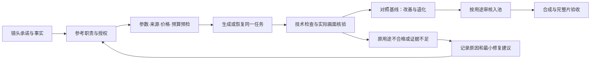

# 镜头生产通用能力升级：沙发垫复盘与实施计划

> **For agentic workers:** 在获得实施授权后，使用 `superpowers:subagent-driven-development`（可用子代理时）或 `superpowers:executing-plans` 执行下列任务。未勾选步骤均为待办，不是已实现能力。本文件不自行授权付费生成、发布或 Git 推送。

**Goal:** 将镜头承诺、参考素材职责、生成恢复、预算和按用途验收接入现有主线，减少重复返工与错误放行，同时保留 Agent 的创作判断。

**Architecture:** 沿用 Agent 驱动的 pipeline、注册工具、品类与品牌配置、版本化 artifacts、ProjectCommitStore 和 ReviewService。代码负责确定性验证、执行和持久化；skills 规定方法与顺序；Agent 和人工判断画面语义及创意，不新建包办创意的总控程序。

**Tech Stack:** Python 工具与契约测试、JSON Schema、Backlot、现有 Seedance 2.5 适配器、FFmpeg、Markdown skills；成片继续沿用获批 Remotion、Doubao TTS 与音乐资产。

**版本／日期：** v1.2，2026-10-16。**状态：文档审查完成，核心实现已在 `codex/shot-source-production-20261016` 接入，已完成独立审查与离线回归验证。** 2026-10-16审查补清了源片入口、scope消费者、唯一父预算账本、并发释放和品类版本兼容；实际实施结果见[实施报告](../../reports/2026-10-16-shot-source-upgrade.md)。

---

## 1. 本轮实际发生了什么

复盘对象是 `sofa-cushion-p1a-v1` 从人物尺度修复、商品纹理修复到 A 镜头 V6 的过程，不是已交付完整片，也不是量产成功率实验。

| 环节 | 已有证据 | 可得结论与限制 |
|---|---|---|
| V3 尺度问题 | 用户指出巨手和玩具沙发观感 | 局部前景手缺少可靠尺度参照，不能只靠负面提示词处理 |
| V4b 比例修复 | 人物同框、双脚与扶手关系改善；3 秒预览曾获用户批准 | 该批准绑定当时版本，不等于后续发现的商品纹理问题已经解决 |
| 六次图片纹理修复 | 前三版残留纹样；第4版改善纹理但裁掉扶手；第5版是较好的全貌候选；第6版又引入退化 | 必须同时检查目标改善和冻结项；最新版不天然优于前版。图片费用未返回，保持未知 |
| V5 提交 | Ark 返回 HTTP 400、`InputImageSensitiveContentDetected.PrivacyInformation`，无任务 ID | 属于服务商明确拒绝；现有适配器却归为 `submission_result_unknown`，需要修复分类，不能盲目重提 |
| V6 输入路线 | 原始生成视频只提供人物参考，两张商品参考图提供外观／织纹；获得明确外传授权 | 这套路线本次成功，不保证每个参考或后续任务都被服务商接受 |
| V6 实际回片 | 4.041667 秒，720×1280、24fps、H.264、97 帧，无声；完整解码通过 | 真正的新动态源片，不是静态图动画，也不是最终成片 |
| V6 画面复核 | 可见手与沙发比例自然、未见明确花卉纹；只拍到左扶手局部；2秒仍接触，2.5秒附近离开，3秒回身旁 | **原定全貌 A 镜头未通过；局部轻抚用途待用户审核。** 八张抽帧不能排除所有帧间瑕疵 |
| V6 用量 | 173,700 token；目录价估算 7.2954 CNY；单次子预算8 CNY；实付未确认 | 约7.30元不是整轮费用，不能漏掉前轮生成、图片编辑或未知结算 |

V6 媒体 SHA-256：`e25ad36d1c7d57afd7788f56cee173924de2f726d1e1dab648280d90119d3461`。运行证据见本地 [源片复核](../../../projects/sofa-cushion-p1a-v1/artifacts/opening_pilot/v6/sofa-hm-a-source-review.md) 与 [源片证据](../../../projects/sofa-cushion-p1a-v1/artifacts/opening_pilot/v6/sofa-hm-a-source-evidence.json)。`projects/` 不入 Git；远端读者可依据本节摘要理解结论，但没有本地媒体时不得声称已独立看片。

本次审计时，工作区已有 Seedance 2.5 带视频输入的计价补丁和新增 pricing 测试，尚未提交；上一轮执行记录为相关 **33 项通过**，本次文档更新没有重跑或扩充测试。其他通用升级仍为下列待办。

## 2. 固化边界

| 环节 | 工具／代码 | skill／规范 | Agent 的判断 |
|---|---|---|---|
| 镜头任务 | 校验必见区域、动作、时序、证据、版本绑定是否齐备 | 先定义可见结果再写提示词 | 景别、场景、第一视觉事件、具体动作 |
| 参考媒体 | 来源、哈希、角色、派生关系、用途与授权验证 | 商品身份、纹理、人物、动作、构图分别分工 | 选哪些参考、解释冲突、提出取舍 |
| 生成 | 参数／价格预检、幂等、状态恢复、并发限制 | 一次只修主要问题，失败先分类 | 提示词、局部动作幅度和镜头运动 |
| 预算 | 父预算、跨修订计数、原币种预占与结算 | 先登记预算和停止条件 | 判断新增尝试是否值得，不能自行扩大授权 |
| 质量 | 抽帧／解码、证据引用、状态与适用性验证 | 同时检查改善和新增退化；按原用途验收 | 判断自然感、纹理、接触、叙事适用性 |
| 入池／审核 | 源片专属审核、可用区间、依赖失效和用途限制 | 先审原用途，再讨论另作他用 | 提出候选用途，用户决定是否采纳 |
| 迭代 | 基线、候选、变化记录、费用与时间汇总 | 预登记假设与冻结项，不能挑结果归因 | 解释变化、选择最佳候选和最小修复 |

不写死为通用模板：白衬衫女性、左扶手轻抚、暖色客厅、1.8秒离手。四秒源片只属于相应制作模式的默认值；不同品类、结构和任务从配置及批准锁读取。AI画面不能证明防滑、耐磨、吸水或其他真实性能。

## 3. 拟议接口与记录合同

以下合同已在本地研发分支接入；字段齐备并不等于批准，仍须通过证据验证和正式用途审核。远端／主干是否包含该能力，以提交和部署状态为准。

### 3.1 镜头承诺与参考素材

在现有镜头／生产锁体系下增加版本化 `shot_source_plan`，与具体 slot、revision 和父生产记录关联，不另建重复的全局状态表。

- 固定身份：项目、镜头 ID、SKU、事实／品类／品牌引用及哈希，原定用途、批准锁和父预算 ID。
- 可观察要求：每项有稳定 ID、是否必需、核验方法、必见区域／动作／结果、适用时间区间及必要的完成截止和结果停留。没有要求的时间字段留空，不给所有动作强加同一时点。
- `global_requirement_ids` 显式指定商品身份等全用途硬要求，每个候选用途都必须满足；完整全貌等仅原用途要求可在合格的局部用途中另行定义。修改用途不能删掉全用途要求。
- 参考集合：每份媒体有本地文件身份、来源／原始或派生属性、父媒体引用、`roles`、用途、不得继承的内容和上传授权引用。角色可多选，但必须说明各自承担范围。
- 视频参考额外绑定原始生成回执、原始字节、实测时长和远端可用性证据。账户关联用不可逆指纹，不存密钥；签名链接不写入公开设计文档。
- 授权校验基于已保存的授权范围：素材集合、用途、接收服务商不变时复用，不重复询问。新增素材或用途超出范围时只确认增量。平台侧是否接受与用户授权分开。

一次只读预检集中返回参数、参考、授权、预算、价格和来源问题。代码检查证据与约束，不能根据关键词假装已经看清织纹或确认尺度自然。

### 3.2 源片结果与审核

扩展统一 `evaluation_report` 的 `scope` 和现有 ReviewService，支持 `source_clip`。原始视频不伪装成三秒品牌预览或完整片；新增范围的全部消费者应在同一发布批次识别它。

- 生成回执、实际媒体哈希／格式／时长、父请求和预算、逐项实际观察、时间点及帧证据共同绑定。
- 正式record还绑定 `generation_inputs_ref` 与 `generation_identity`。实际回执的成功、媒体哈希、task／attempt、项目／镜头／修订／父预算／谱系／原请求及指纹必须匹配，历史缺失时拒绝送审，不能用无关回执补齐。固定模型时实际返回模型也必须相同。
- `pass / fail / not_run / error` 保留真实结果；不适用项另外说明理由。无声源片的口播检查不适用，不表示缺失；声明有口播的成片缺少检查仍为未完成。
- 记录审核者类型、实际输入模态及覆盖范围：制作 Agent、独立 Agent、人工最终批准分开。两个 Agent 看同样抽帧不是两次独立生成，也不等于完整动态回放。
- 技术状态、原用途满足状态、候选用途、人工审批分别保存。内容语义结论由 Agent／人填证据，代码只验证完整性与放行规则。
- 源片审核绑定媒体、镜头要求、事实、品类、相关品牌依赖及所审用途。任一相关依赖变化后，新版本须重审；单纯重新签发相同字节的下载链接不视为商品内容改变。
- 全貌任务失败时，保留原任务失败；用户可另行批准“局部轻抚”用途，但不得把旧任务改为成功，也不能据此交付完整片或计入300条。

Backlot 源片卡展示原要求与实际所见、参考缩略图、原片播放、带时间点证据、未完成项、用途／区间和费用。列表区分“生成成功、待检查、原用途合格、原用途不合格、待人工审核”；从同一 canonical 记录派生显示。

正式存储按 `artifacts/shot_sources/<shot_id>/<revision>/` 分隔，包含 `plan.json`、`evaluation.json`、`record.json`，不使用项目级单一source报告覆盖多个镜头。ReviewService增加 `create_source_clip_review(record_path, purpose_id, interval, submitted_by)`；提交入口为 `POST /api/v2/projects/{project_id}/source-reviews/{shot_id}/{revision}/prepare`。subject绑定镜头／修订／用途／选段及依赖哈希；审核决定不推进任何script/sample checkpoint，不写final approval。工作台从canonical记录派生列表，不维护第二份可变状态。

scope接入矩阵：schema注册与artifact_io识别source_clip，但仅允许显式镜头路径写入；repair引用原镜头报告路径，不能回退sample；operator/state展示源片卡；checkpoint、交付、batch作品计数明确排除source_clip作为成片证据；未知scope拒绝，不默认归final。source无口播时不创建sample/final alignment；现有alignment范围保持原语义。

### 3.3 失败状态与跨修订预算

| 情况 | 执行状态与恢复 | 费用处理 |
|---|---|---|
| 本地预检或自动审批阻断，尚未发请求 | 明确未提交；补齐已授权问题后再执行原计划 | 未提交不产生本次API用量；已有预占按既定账本规则保留或释放，不能混同历史未知费用 |
| 服务商明确拒绝，响应确认未建任务 | 保存HTTP状态、错误码、request ID及是否建任务；停止显示生成中，不自动重试 | 费用仍独立标为待核实，不能仅凭HTTP400自动结算零元 |
| 请求已发出但响应未知，无任务ID | 保留未知；核对原请求与账户记录，不重复POST | 保留相应预占及并发占位 |
| 已知任务ID，等待或失败 | 查询同一任务，依据终态处理 | 关联原预占与实际usage，查询不重复入账 |
| 生成成功但创意不合格 | 保留源片和失败原因；按批准次数判断是否可返工 | 仍计入消耗，不能当免费重试 |

请求归属固定 `shot_id + lineage_id + parent_budget_id`；修改版本或幂等键不能重置同一任务累计额度。技术重试、创意返工、获批新路线分别归因，但都按真实授权归属汇总。明确未创建任务，或已知任务确认成功／失败终态，都可释放活动并发占位；响应未知继续占位。累计调用次数、资金承诺与活动并发是三种独立口径，不能随并发释放一并清零。

新父预算使用项目内唯一 `artifacts/budgets/generation.json` canonical账本，父预算ID、币种、金额／次数上限及授权引用一并绑定生产锁。不同revision与工具在同一文件锁内核验并预占；子请求不得改用其他路径绕开总额。金额计算使用Decimal或整数最小单位；未知实付保留资金承诺，跨币种不相减，本轮不新增自动汇率换算。预占采用唯一请求标识，崩溃恢复复用原条目，不重新预占；并发测试覆盖不同进程／修订／工具争夺最后余额和最后次数。

扩展现有 CostTracker 为原币种父／子预算约束，不再依赖临时“USD1代表CNY8”的数量代理。兼容旧美元账本但不伪造汇率；未知币种／价格不发起新付费调用。原子预占同时约束金额和次数，保留预占、目录估算、实付、未知项及其证据，未知费用不被已知费用合计掩盖。

## 4. 制作与修复流程

返工箭头必须经过剩余授权与预算检查，不代表无限自动循环。达到上限只停止重试，保留失败／待修状态；改用途、改路线或扩大预算分别按已有授权边界处理。**不允许“两轮仍有关键问题则带警告通过”。** 普通建议可以接受，SKU错误、必要构图缺失等硬失败不能被建议分数覆盖。

参考图编辑先指定允许变化的区域与必须保持项，再比较原始商品依据、当前最佳候选和新结果；不能让模型沿着已有错误花纹继续衍生。原商品证据始终优先于AI派生图。编辑方法改变应遵守用户对工具和处理方式的授权，不默认改用脚本贴纹理。

大件家居的 skill 与品类说明补充：尺度参照可辨、手与身体连接合理、同一纵深、商品覆盖范围、接触与结果可见。具体尺度参照可以是人或其他合适物体，由 Agent 根据任务选择，不要求每镜都出现全身人物。

优先扩充现有 `seedance-2-5`、`dynamic-opening-pilot`、asset/sample director、reviewer/repair，清理通用 skill 中的 `towel motion` 等残留。不要新建大量相互重复的 skill；通用方法在skill，特定品类要求在profile，本次镜头参数在锁。

## 5. 迭代评价：怎样证明变好或变坏

使用 [镜头源片验收卡](../../templates/shot-source-review-card.md) 和 [镜头迭代对照卡](../../templates/shot-iteration-comparison-card.md)。它们是人工填写模板，正式记录和用途审核已接入本地分支；模板本身不会创建批准。

| 时点 | 负责人 | 必须填写 |
|---|---|---|
| 生成前 | 制作Agent，用户确认必要决策 | 唯一主目标、基线、冻结项、允许变化、参考职责、预算与停止条件 |
| 返回后 | 工具 | 原始回执、usage、实际媒体身份、探测／解码及抽帧 |
| 质量复核 | 制作Agent；关键首件增加独立复核 | 实际画面、问题时间点、检查方法与覆盖范围、目标与冻结项逐项结果 |
| 采用前 | 人工审核者 | 原用途是否通过、是否接受其他用途、具体文件和区间、未解决问题 |
| 批次复盘 | Agent基于同源记录汇总 | 原用途首次合格率、服务成功率、返工、成本、时间和未评判数量 |

先检查硬要求，再比较表达质量。结论分别为改善／退化／持平／有取舍／证据不足；存在原用途硬失败时，不允许以“整体改善”晋升原用途基线。改变模型、参考、构图等多个因素时，只比较整套方案，不能宣称单一提示词造成提升。

源片评价关注商品外观、构图完整、物理比例、动作与可见结果、稳定性及可剪辑性；完整片继续使用既有六维创意评价和视听核验。无音频源片不打声音零分，不把钩子留存或销售效果填入未发布素材。

| 指标 | 口径 |
|---|---|
| 原用途首次合格率 | 首次提交且完成最终源片判定的镜头中，原用途通过的比例；待评判单列，不从分母悄悄删除失败 |
| 服务成功率 | 已结束并有确定服务结果的任务中成功比例；结果未知单列，不代表质量合格 |
| 每条原用途合格素材成本 | 同一生产范围全部相关尝试成本／原用途验收通过数；分母为零时未定义，未知结算并列展示 |
| 时间 | 排队、提供方执行、Agent主动工作、人工主动工作、审批等待、渲染、返工分别记；未测量留空，不用文件时间差推测工时 |
| 经营效果 | 仅在发布后按统一口径回收；本轮没有数据，不推断留存或转化提升 |

本轮V6作为“技术成功但用途不合格”的真实回放案例。仅有少数案例和抽帧证据，不能建立统计可靠的量产通过率，也不应自动标为Gold样本。

## Chunk 1：安全恢复与一致记录

### Task 1：统一规则并收尾已有计价补丁

**修改入口：** `skills/meta/reviewer.md`、`.agents/skills/seedance-2-5/SKILL.md`、`tools/video/seedance_ark.py`。**已有测试：** `tests/contracts/test_seedance_ark_reference_pricing.py`、`tests/contracts/test_seedance_ark_recovery.py`。

- [x] 对照批准方案修正“重试上限即放行”的规范，并让所有相关director引用同一规则。
- [x] 核对现有pricing补丁：带视频输入计入输入时长，无已知价格组合继续拒绝预检，不扩大分辨率或模型范围。
- [x] 运行 `.venv/bin/python -m pytest tests/contracts/test_seedance_ark_reference_pricing.py tests/contracts/test_seedance_ark_recovery.py -q`；预期全部通过，禁止网络请求。此前33项是历史记录，不替代本次实现后的结果。
- [ ] 单独提交此可验证变更，保留当前已有未提交工作身份，不覆盖其他工作。

### Task 2：错误分类、来源预检与预算归属

**修改入口：** `tools/video/seedance_ark.py`、`lib/generation_attempts.py`、`lib/dynamic_hook_pilot.py`、`tools/cost_tracker.py`、`lib/cost_persistence.py`、`schemas/artifacts/cost_log.schema.json`。**新增测试：** `tests/contracts/test_generation_reference_gate.py`、`tests/contracts/test_generation_parent_budget.py`；扩展既有recovery测试。

- [x] 先写失败用例：明确拒绝／无响应未知／已知任务三类；过期URL、原始字节改变、只授权图片却新增视频；跨版本超限和并发预占。
- [x] 增加结构化provider错误与媒体来源预检，复用已有journal和幂等，不建立第二套任务系统。来源预检本身不授权上传；需要访问远端时仍受已授权接收方和用途约束。
- [x] 增加父预算与修订关联、原币种预占；明确拒绝与费用结算分离。旧V5仅补分类证据，不覆写原始回执或把未知费用改成零。
- [x] 运行既有recovery／pricing及上述新契约测试；期望同key最多一次POST、未知结果不重复提交、金额与次数均不可越限。
- [ ] 按恢复与预算两个独立可回滚提交交付，记录实际测试结果。

## Chunk 2：镜头验收与审核台闭环

### Task 3：镜头承诺与源片证据

**新增：** `schemas/artifacts/shot_source_plan.schema.json`、`lib/shot_source_contracts.py`、`tests/contracts/test_shot_source_contract.py`。**扩展：** `schemas/artifacts/evaluation_report.schema.json` 及现有artifact注册、动态镜头validator。

- [x] 先写反例：全貌缺右扶手、错误织纹、截止时间后才离手、无证据却pass、抽帧被标为完整回放、错误版本绑定。
- [x] 实现第3节的最小合同，使用事实／品类／品牌既有引用，不复制事实来源或做自动审美判定。
- [x] 扩展 `source_clip` 范围；处理全部读取分支，禁止未知范围落入final默认分支。原范围和旧记录保持兼容。
- [x] 使用V6及脱敏合成fixture验证“技术pass、原用途fail、另作用途pending”可以同时真实表达；仅播放／探测本地资产，不发生成请求。
- [x] 新source契约与 `tests/contracts/test_evaluation_report_contract.py` 已通过；Git提交待办独立保留。

### Task 4：源片审核和用途入池

**修改入口：** `backlot/operator_reviews.py`、`backlot/production_review_items.py`、其对应审核页组件与路由。**新增测试：** `tests/backlot/test_source_clip_reviews.py`；回归 `tests/backlot/test_final_production_reviews.py`、`tests/backlot/test_opening_reviews.py`。

- [x] 先写测试证明源片批准不能作为preview或final批准，素材／要求／用途变更会使相关批准失效。
- [x] ReviewService增加source审核入口，复用已有事务、版本、幂等机制；工作台从同一记录展示，不另建手工状态索引。
- [x] 显示原目标与实际结果、逐项核看、视频、时间点、候选用途和费用；原用途失败保持可见，接受局部用途另记批准。
- [x] 回归既有毛巾开头、完整片、沙发垫品类提示和交付计数；源片不计为独立完整作品。
- [ ] 验证后单独提交，保持旧审核记录只读可追溯。

## Chunk 3：方法沉淀与离线验收

### Task 5：接入skills与迭代卡

**修改入口：** 既有asset/sample director、reviewer/repair、`seedance-2-5`、`dynamic-opening-pilot`；新增 `config/category_profiles/sofa-cushion-v2.json`，保留v1字节；本文两份模板。

- [x] 将参考分工、尺度／接触、目标与冻结项复核、最佳候选选择、重试停止写入现有skills，清理毛巾专属提示。
- [x] v2品类规则只增加跨镜头适用的核看方法；具体人物、动作时点仍从单镜头锁读取。新锁显式选v2，历史引用继续读原v1，不修改其字节或静默重绑批准；验证新旧审批不能互用。
- [x] 将工具输出填入卡片、Agent语义观察和最终人工决定分栏，汇总指标使用第5节固定口径。
- [x] 在合同与skills中强制声明完整回放／抽帧覆盖范围；本轮只回放合同和历史观察标签，不补造原片完整观看证据。
- [x] 文档／skill与schema语义已核对，无法自动核验的画面判断保持具名Agent／人工证据；Git提交待办独立保留。

### Task 6：统一回放验收与上线

- [x] 固定离线观察标签：V3/V4b、图片第4/5/6版、V6；V5拒绝通过结构化提供方回归覆盖。它们用于合同回放，不是新增视觉实证或Gold Set。
- [x] 重点验收：硬失败不能被分数或重试次数抵消；旧批准不能跨版本／用途／范围使用；无声源片不误判为口播缺失；失败与未知成本不丢失。
- [x] 针对性测试通过后运行仓库 `make lint`、`make test` 及改动涉及的工作台构建／测试；修复新增失败，不以跳过检查换取上线。
- [x] 在独立研发分支审查后交付已验证实现；当前“先review下文档，然后实施”授权本地研发，主干合并与远端推送按用户明确指令执行。
- [x] 源片记录与人工门已接入，不开启付费自动返工。
- [ ] 待生产执行授权后补当前缺失的合格全貌镜头，并继续完整片。

## 6. 兼容与文档边界

- 既有毛巾300条方案、品牌规范和已批作品不改写；源片能力为各品类提供共同基础，不改变内容配额或已批准时长。
- 历史记录缺新字段时显示“历史未记录”，不得生成假的审批、任务、付款、阶段完成或机器分数。
- 文档描述的目标与当前代码不一致时，必须显示“待实现”；不要把本文当成已发布API说明。
- 当前总评价入口仍为 [总体评价体系](../../EVALUATION_SYSTEM.md)，跨品类入口为 [跨品类生产契约](../../category-profile-cross-category.md)。既有成片迭代评价沿用原框架，本方案补的是源镜头层，不另建平行评分体系。
- 本轮运行时skills已同步规则，但不改变当前沙发垫项目待人工审核状态；模板填写不等于审批，未进行新的付费生成、完整片验收、发布、主干合并或远端推送。

### 实施收尾（2026-10-16）

本地分支核心代码、运行时skills、schema、审核台及离线回归已完成。全仓回归3543 passed、11 skipped、1 subtest passed；最后补充的原币种pilot接入连同核心合同回归182 passed（最后复跑5.60秒）。lint、前端语法与diff检查通过，独立审查无剩余阻断。Git提交／主干合并／推送仍未执行；上方相应提交待办保留，生产执行授权仍独立。
